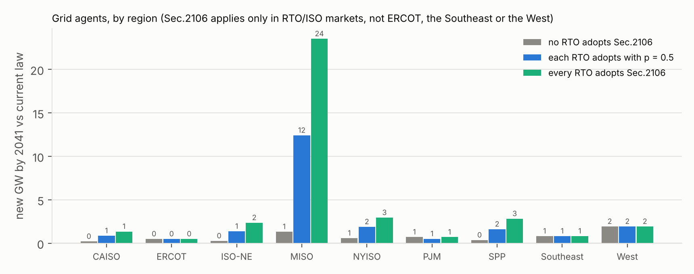

# What BAAJA would do to US electricity supply: a simulation of permitting, courts and the interconnection queue

*Methods and results brief, 24 November 2026. Model, data and code: this repository. Full model description:
[`docs/ODD.md`](ODD.md). Section map of the bill: [`docs/bill_question_map.md`](bill_question_map.md).*

## Summary

The Bipartisan American Affordability and Jobs Act (BAAJA) was introduced as S.5653 on 30 September 2026 and adopted
with changes as S.Amdt. 6883 to H.R. 2347, which the Senate passed on 19 November 2026 by 62 to 33. The House has
not yet acted on it, so it is not law; the model assumes enactment in November 2026, and later enactment moves every
date below by the same amount. This brief asks how much generating and storage capacity the Senate-passed text would
bring online in the United States by 2041,
in which regions, and what that does to regional reserve margins.

By November 2041 the bill adds 6.5 GW of new capacity if no RTO/ISO changes its interconnection process under
Sec.2106, and 65.0 GW if every one does, against about 972 GW that comes online under current law. Where between the
two it lands depends on how many RTOs change their process, which nothing in the record predicts. The central case,
with each RTO changing with probability one half, gives 36.5 GW; it is close to the midpoint of the two bounds and is
a convention. Of the 36.5 GW, 25.3 GW are renewables, 6.4 GW gas and 4.8 GW storage. About 3.5 GW of
the 6.5 GW comes from the extra hosting room the model credits to Sec.2109 (advanced transmission technologies); the
permitting, court and permit-certainty provisions on their own add 3.0 GW. Existing hydro whose new license comes
sooner accounts for a further 1.8 GW; this is existing capacity kept in service, and I do not count it as new
capacity.

The size of the Sec.2106 effect rests on three things the statute does not settle. The first is whether an RTO's
process changes at all (FERC may find existing processes compliant under Sec.2106(d)). The second is what the single
decision point removes. In the model it removes the current-law re-study round, which I fitted to SPP's posted cluster
studies for 2016-23: agreements came a median of 17 months after the first complete study result, and the upgrade
costs of the requests that stayed moved by a median of -8% with a wide spread. With that round, Sec.2106 is worth
58.6 GW if every RTO changes its process. If re-studies took the 150 days that FERC Order No. 2023 now requires, it
would be worth 34.2 GW, and with no re-study round under current law, 1.1 GW (section 4.5). The third is
the entry screen that stands for the non-refundable security. With every RTO changing its process, the bill adds
72.1 GW with no screen, 65.0 GW with the relative screen used here, and 41.0 GW with the absolute threshold I first
specified. I changed from the absolute to the relative version after seeing results (section 2). Drawing the
assumption ranges of section 5 together, with the relative screen and the calibration held fixed, gives a median of
37.7 GW [4.6, 90.1] (5th-95th percentile of 400 joint samples).

These numbers are higher than in my previous draft (21.9 GW central, 37.0 GW with every RTO), for three reasons. I
replaced my assumed re-study round (a six-month round with a cost rise of 0.3 per withdrawn share) with the SPP fit,
and I added the share of requests that LBNL's own fit says fail at any cost, which corrected how the model reads PJM's
cost data. Transmission that MISO, SPP and PJM have already approved is now in both runs and adds about 4.6 GW to the
central gain (29.3 against 24.7 GW in 20 paired runs).

Little changes before the early 2030s. The model assumes reformed interconnection studies start about three years
after enactment (range two to four; the bill gives FERC 18 months for the rule and RTOs two years from enactment to
file, and under Order No. 2023 the first compliance orders came 20 to 24 months after the rule), and that requests
already in the queue keep their current terms. By 2030 the bill has added 0.3 GW; by 2035, 19.0 GW.

The gain is concentrated in MISO, with 20.2 of the 36.5 GW, and MISO accounts for 62% of what Sec.2106
adds (64% if every RTO changes its process), so the result is close to a question about whether MISO's process changes. MISO gains because its fitted study
capacity falls short of the requests arriving; with PJM's ratio of study capacity to arrivals, MISO's gain with every
RTO changing falls from 39.1 to 24.7 GW. PJM gains 4.6 GW in the central case and 7.6 GW if every RTO changes its
process; without the entry screen it would gain 15.4 GW. ERCOT is outside FERC's rate and interconnection
jurisdiction, and the Southeast and most of the non-ISO West have no RTO, so Sec.2106 does not reach them. ERCOT gains
from the permitting and court provisions only; the Southeast and the non-ISO West also gain from Sec.2109, which
applies to FERC-jurisdictional public utilities, including those outside RTOs.

Under current law the national shortfall below NERC's Reference Margin Levels reaches about 68 GW in 2035 (27 to 132
GW when demand growth, retirements and accreditation are drawn jointly) and 112 GW in 2041, most of it in PJM, whose
installed reserve margin, as reported by NERC, rises from 18.6% in 2026 to 35.1% in 2034. NERC's forecast ends in
2035; the 2041 figure extends demand at its 2030-35 growth rate and holds margins at their 2035 levels. BAAJA reduces
the 2035 shortfall by 4.9 GW [0.4, 9.7], and by 9.0 GW if every RTO changes its process. The shortfall is a benchmark
against NERC's planning margins and says nothing about outages. The bill does not close it, with or without the entry
screen.

The published estimates measure different things. Resources for the Future reports about 60 GW more clean capacity
in 2028 (Rennert and Bergman 2026); this model's gain by 2028 is zero, because reformed studies start about three
years after enactment. Rhodium Group reports 17 to 249 GW more clean capacity through 2040, a range across technology
costs and fuel prices (King et al. 2026); this model's gain in renewables and storage by November 2041 runs from
5.9 GW if no RTO changes its process to 52.7 GW if all do. Both studies are capacity-expansion models that report net
changes in a fleet that meets demand, and both expand transmission under the bill; this model counts gross additions
from the queue and adds no transmission in response to the bill. RFF names permit certainty and faster
interconnection as the primary drivers of its near-term gain, and each study, including this one, sets the extent of
interconnection relief by assumption.


## 1. The bill and the question

BAAJA is a permitting and transmission bill. The provisions that bear on generating capacity fall into four groups
(full map, with each section's status, in `docs/bill_question_map.md`):

| group | main sections modeled | what changes in the model |
|---|---|---|
| Permitting | 1105 and 1108 (level of review), 1106 (enforcement of the existing one-year EA and two-year EIS deadlines, new deadlines for decisions after the review), 1202 (tighter rules on the existing one-year Clean Water Act s.401 clock), 1302 (ESA consultation timeline), 2213 (clocks for renewable and storage rights-of-way on federal land), 2229 | months to a federal permit |
| Courts | 1110 (150-day limit, comment exhaustion and remand without vacatur for NEPA claims) and 2201 (150-day limit and expedited review for energy authorizations); 1134 sets a 150-day limit for FAST-41 claims (1205 and 1305, for s.404 approvals and ESA opinions, are listed but not modeled separately) | how many suits are filed and how many halt a project |
| Permit certainty | 1401 | whether a permit can be revoked or suspended after issue |
| Grid access | 2106 (interconnection reform in RTOs/ISOs), 2110 (study automation), 2109 (advanced transmission technologies), 2101, 2102(a) and 2214 (transmission permitting) | who enters the interconnection queue, who leaves it, how long studies take, how much hosting room the grid has |

Sections 1203 and 1204 (NPDES permit term and Clean Water Act s.404) are listed but not modeled, because they act
on existing plants and on wetlands permits the model cannot attach to generation projects.

The model asks how much capacity comes online by region and year with and without the bill, and what that does to
each region's reserve margin. It does not estimate prices, emissions or customer bills.

Several provisions that bear on supply are outside the model. Sec.2107(b) confirms that states may condition retail service to a
data center on new generation it procures, which acts on the demand behind the adequacy gap. Sec.2108 bars RTOs from
blocking aggregations of behind-the-meter storage, fuel cells and generators of 5 kW to 5 MW each from wholesale markets,
which is capacity outside the interconnection queue. Sec.2102(b) exempts interstate gas pipeline looping and
compression in existing corridors from NEPA review. Sec.2109 also requires public utilities to evaluate advanced
technologies on existing lines and deploy them where benefits exceed costs; the model credits only extra hosting room
on lines finished after month 36, later than the one year the statute gives FERC for its order.
Sec.2103 (new interregional planning with cost allocation; regional planning is deemed met by Order No. 1920) is, in
my reading, the bill's main route to new transmission, and the model adds no transmission in response to the bill. Sec.1501-1504 (nuclear licensing) are listed
because no new reactor reaches operation through the queue data by 2041.


## 2. The model

The full description, in the ODD form of Grimm et al. (2020), is in `docs/ODD.md`. In short, it is a model of the
interconnection queue with decision rules for grid operators and developers, coupled to a permitting and litigation
pipeline and to a supply-and-adequacy account.

Projects. Every generation, storage and transmission request from 2026 to 2041, plus the queue standing at the end
of 2025, is drawn from LBNL interconnection-queue data by technology and region (Rand et al. 2026). Each goes through
federal permitting if it has a federal hook, possible litigation, possible federal halt, interconnection and
construction. Permitting and litigation are sized from CEQ, BLM, Army Corps and NEPA-litigation data.

Grid operators, one per region, study requests in clusters (ERCOT one at a time) with a throughput fitted to LBNL
request-to-agreement times. They allocate network-upgrade costs drawn from LBNL's regional cost studies; costs rise
with the capacity signed in a region (by a rate fitted to LBNL cost data for requests made since 2018 against
2010-17; zero in ERCOT, which did not allocate network upgrades to generators through 2025) and fall as transmission
is finished. Transmission already approved under current law adds room as it enters service, in both runs: MISO's
Long Range Transmission Plan Tranches 1 and 2.1 ($32.2 billion, in service 2028-34), SPP's 2025 Integrated
Transmission Plan ($8.6 billion) and PJM's 2025 Regional Transmission Expansion Plan lines of 500 kV and above
($9.8 billion), each counted in project-equivalents at the cost of an average Tranche 1 project ($0.57 billion). The
in-service years of Tranche 1 and the spread of the SPP and PJM portfolios over 2030-32 are my assumptions.

Under current law in cluster regions, the operator runs one re-study round after the first complete study result.
When requests withdraw, the upgrade costs of those who stay change by 0.1 times the share of capacity that withdrew,
each request's cost also moves by its own lognormal factor (median -8%, spread 0.6 in logs), and the agreement comes
17 months after the first result. All four values come from SPP's posted results for its 2016-23 clusters (nine
clusters, postings from 2020 to 2026; `data/spp_restudy.json`). The cost rise per withdrawn share is not
distinguishable from zero (standard error about 0.8); the spread of costs at re-study is large and well measured. SPP
is the one RTO whose successive cluster postings I could obtain, and its clusters predate Order No. 2023, whose
pro forma tariff requires a cluster restudy within 150 days.

Developers enter on the published wait and on their region's projected capacity shortfall. At each study result they
compare the allocated upgrade cost with the project's value and stay or leave. The shape of the value distribution
comes from LBNL's fit of completion on upgrade cost, which also says that a share of requests do not complete at any
cost: 23% in RTO regions and 51% elsewhere. In the model those requests leave whatever their cost, so drawing a zero
cost is not on its own a route to completion. The level of value is one scale per technology and region, fitted so
that completion matches LBNL's rates. The scales run from 0.007 to 148, so value here stands for every reason a
project completes or not that the model does not otherwise represent; it is not revenue, and the model has no prices.
Developers also withdraw over time at background rates fitted by region.

Supply. What comes online is added to the EIA-860 fleet, less announced and age-based retirements, and compared with
NERC's 2025 peak-demand forecast and reference margin levels (NERC 2026). Wind, solar and batteries count at on-peak
shares that start at NERC's national values and fall halfway to PJM's 2041/42 ELCC class ratings by 2041 (on-peak
accredited capacity below).

The bill enters as mechanisms. Under Sec.2106 a reformed RTO publishes planned interconnection locations
with "an upfront, fixed, subregional, per-megawatt fee" (new FPA s.228(a)(2)(B)), holds a single decision point, and
requires "meaningful and nonrefundable financial security" and "withdrawal penalties after the determination of total
costs of interconnection ... are provided to the customer" (s.228(a)(3)(B) and (C)). Four choices here are model
assumptions; the statute does not make them. The single decision point removes the current-law re-study round for
every request made after the rule in an RTO whose process changes: requests that stay sign at the cost in their
first study result, 17 months sooner, and the cost that other requests' withdrawals would have shifted onto them is
assumed to be covered by forfeited security and penalties, which the model does not check. The fee is set at the
region's expected upgrade cost, so requests at a published location face no cost shock at the study result; those
requests are exempt from the screen; and the security in (B) is represented as an entry screen, applied before costs
are known, while the penalty in (C), which applies once costs are known, is not modeled separately. Within each
technology and region, the quarter of new requests least likely to complete (range a tenth to a half) do not enter.
A quarter is close to the median share of 2015-19 requests that RTOs saw withdrawn within a year (median about 0.3 across the six
FERC-jurisdictional RTOs in LBNL's data, from 0.14 in SPP to 0.58 in CAISO), the requests that Johnston, Liu and Yang
(2023, revised 2026) find higher entry costs deter. For PJM they find that higher queue-entry costs have little effect
on completed capacity (-1.2% to +0.8%) or on waiting time, because they mainly deter requests that would have left
quickly. The modeled screen is harsher than that: it removes 7.8 GW of completions in PJM and shortens the queue in
MISO, so their result is closer to the no-screen case in section 4.4 than to my central case. Each RTO's process
changes with probability 0.5 in the central case, drawn independently for each RTO.

The screen was first specified as an absolute threshold: requests whose modeled chance of completing was below
0.25 did not enter. After an earlier refit of the calibration, that threshold kept out nearly all new storage
requests in PJM, because the refit had put several developer value scales at the bottom of their allowed range,
where few requests clear an absolute threshold. An absolute threshold on the modeled chance of completing depends on
those fitted scales; a screen defined as a share does not. Under the calibration before that refit, with every RTO
changing its process, the relative screen gives +68.1 GW against +65.0 now, and the absolute one +42.3 against +41.0
(`results/sec2106_decomposition.md`, section F). I changed to the relative screen after seeing results; I should have
specified it that way before running. The relative screen is a quota, though: it fixes the share kept out instead of
deriving it from the size of the deposit, and where value says little about completing it is close to a random cut
(in PJM storage, 109 of the 162 requests per run that sign after the rule pay no upgrade cost). Both versions, and no
screen, are reported in section 4.4. Sec.2110 is a study-throughput gain, zero in the central case because the bill
sets no target. Sec.2109 adds hosting room per transmission line finished after the rule.

Each bill scenario is run against current law with the same random numbers, so differences come from the bill
instead of sampling noise. There are 100 paired runs per scenario and 400 joint Latin-hypercube samples of every
assumption range for the uncertainty analysis (Saltelli et al. 2008).

A simpler version of the model (Sims 1-6) draws interconnection time from the historical distribution instead of
from the queue. Its results appear alongside as a check and are labeled as such.

## 3. Data

All inputs are public. Sources, retrieval dates and file hashes are in `data/SOURCES.md`.

- Interconnection: LBNL *Queued Up* workbook (requests through 2025) and LBNL interconnection-cost studies for MISO,
  PJM, SPP, NYISO, ISO-NE and non-ISO balancing areas (used for the Southeast and West). SPP's DISIS results
  workbooks for clusters 2016-2 to 2023-1, every posting (the re-study round). PJM's planning-queue export and ERCOT's
  monthly Generator Interconnection Status reports (December 2018-2025 and October 2026), used as checks. The CAISO,
  MISO and NYISO queue files were downloaded for cross-checks but are not used.
- Transmission plans: MISO MTEP25 Chapter 2 (Long Range Transmission Planning), SPP's 2025 Integrated Transmission
  Plan and PJM's 2025 Regional Transmission Expansion Plan.
- FERC: the orders on Order No. 2023 compliance for CAISO, ISO-NE, NYISO, PJM and SPP (2025-26), used for the timing
  and adoption assumptions. MISO's order could not be retrieved.
- Permitting: CEQ EIS timelines, BLM MLRS rights-of-way cases, Army Corps permit data.
- Courts: a case-level export of 1,821 NEPA cases filed 2001-22 (supplied; publisher to be recorded in
  `data/SOURCES.md`); Sabin Center renewable-opposition database.
- Fleet, retirements and generation: EIA-860 (2015-2025), EIA-860M, EIA-923.
- Demand and adequacy: NERC 2025 Long-Term Reliability Assessment; PJM ELCC class ratings.
- Bill text: the Senate floor copy of S.Amdt. 6883 (KAT26804 V62), checked against the engrossed Senate amendment to
  H.R. 2347 (GovInfo, BILLS-119hr2347eas). All 83 sections are identical in letters and digits, apart from two section
  labels in Sec.2301-2302 and the attestation at the end.

## 4. Results

All numbers in this section are from the grid-agent model (Sim 7, `results/sim7_grid_agents.json`): means across
100 paired runs, with the 5th and 95th percentiles in brackets, for capacity online by November 2041. New capacity
excludes relicensed hydro, which is reported separately.

### 4.1 How much, and under which assumption about Sec.2106

| scenario | new capacity GW | renewables GW | gas GW | storage GW |
|---|---|---|---|---|
| BAAJA, no RTO changes its process (Sec.2106 off) | +6.5 [+4.6, +8.3] | +4.9 | +0.6 | +1.0 |
| BAAJA, each RTO changes its process with probability 0.5 (central) | +36.5 [+11.2, +60.5] | +25.3 | +6.4 | +4.8 |
| BAAJA, every RTO changes its process | +65.0 [+57.7, +71.1] | +44.5 | +12.4 | +8.2 |
| BAAJA, central, plus a 25% study-throughput gain under Sec.2110 | +57.5 [+38.0, +76.2] | +37.3 | +10.8 | +9.4 |

Current law brings about 972 GW of new capacity online by November 2041 [956, 987]. The bill adds 0.7% to 6.7% to
that (3.8% in the central case), depending on how many RTOs change their process. The first row, which keeps every
provision except Sec.2106, contains the permitting, court and permit-certainty provisions (Division A, Titles I-IV;
Division B, Title II), Sec.2109, and Sec.2110 at zero; Sec.2109's extra hosting room adds about 3.8 GW to the central
case (+32.7 GW without it). With Sec.2106 and Sec.2109 both off, the remaining provisions add 3.0 GW [1.7, 4.6]
(`results/sec2106_decomposition.json`). Existing hydro whose new license comes sooner accounts for a further 1.8 GW
in every bill scenario; it is existing capacity kept in service.

The interval on the central row is wide because it mostly records which RTOs happen to change their process in each
run. The two rows around it bound it, and the probability of one half is an assumption: Sec.2106(d) lets FERC find an
existing process compliant, and nothing in the record says how often it will. The closest precedent points both ways.
Under Order No. 2023, FERC accepted each of the five RTO filings I could retrieve in part, let every one keep its
existing cluster process through variations, and required further filings from all five (FERC orders of 2025-26 on
CAISO, ISO-NE, NYISO, PJM and SPP). Adoption is drawn independently for each RTO here, although one FERC rule sets the
standard for all six and FERC treated them alike in 2025, so the central row's spread understates the chance of
all-or-nothing outcomes. The simpler model, with study times drawn from history and Sec.2106 and Sec.2110 set to
zero, gives +8.0 GW [+6.1, +9.6] for the permitting, court and certainty provisions, and has no Sec.2109. With the
grid agents the same provisions give 3.0 GW. The first row's total is close to the simpler model's by coincidence;
on the provisions the two models share they differ by a factor of 2.7.

Part of the gain is timing. With every RTO changing its process, new requests in RTO regions add 62.3 GW online by
November 2041, but only 48.4 GW more of them ever complete; the difference, about 14 GW, would have come online after
2041 anyway and arrives earlier under the bill (`results/sec2106_decomposition.json`).

### 4.2 When

| year (to November) | current law: new GW that year | BAAJA central: cumulative GW vs current law | no RTO changes | every RTO changes |
|---|---|---|---|---|
| 2028 | 90 | +0.0 | +0.0 | +0.0 |
| 2030 | 109 | +0.3 | +0.3 | +0.3 |
| 2032 | 55 | +0.6 | +0.6 | +0.6 |
| 2033 | 62 | +2.9 | +1.1 | +4.6 |
| 2035 | 56 | +19.0 [+5.1, +32.6] | +1.8 | +34.0 |
| 2038 | 53 | +29.2 | +3.7 | +53.3 |
| 2041 | 50 | +36.5 | +6.5 | +65.0 |

The bill adds under 1 GW before 2033. The permitting and court provisions add a little each year from the start.
The model applies Sec.2106 only to requests made after reformed studies start (late 2029 in the central case, an
assumption; the statute is silent on requests already queued), and the first of those come online in 2033.
Current-law additions peak at 115 GW in 2029, while the queue standing at the end of 2025 is being built, then
settle at 50 to 62 GW a year. The peak is about twice the largest year in EIA-860 for these technologies (57.6 GW in
2025); the model puts no supply-chain or labor limit on construction.

### 4.3 Where



Of the 36.5 GW in the central case, 20.2 GW is in MISO; if every RTO changes its process, MISO gains 39.1 of the
65.0 GW. ERCOT, the Southeast and the non-ISO West gain 0.5 to 1.7 GW each from the provisions that apply everywhere.

MISO's share comes from its queue. Its fitted study capacity at the end of 2025 is 0.59 of the requests arriving,
against 0.97 in PJM, so MISO's ratio is among the lowest and a faster process and fewer entrants both shorten the queue.
With PJM's ratio, MISO's gain with every RTO changing its process falls from 39.1 to 24.7 GW
(`results/sec2106_decomposition.json`).

PJM gains 4.6 GW in the central case and 7.6 GW if every RTO changes its process, against 0.8 GW with Sec.2106 off.
Without the entry screen it would gain 15.4 GW, and the screen costs PJM more than any other RTO: 7.8 GW, against
1.7 in SPP, 1.3 in CAISO, 1.2 in NYISO and 0.7 in ISO-NE. In MISO the screen adds 5.6 GW, because fewer entrants
shorten its queue. PJM loses most because, within a technology, value there says little about who completes. In
LBNL's cost study 13.7% of PJM requests pay no upgrade cost, about as many as the 13.7% of PJM solar requests and more
than the 7.5% of storage requests that complete. The calibration therefore sets low values for both, and in the model
175 of the 482 PJM solar requests and 109 of the 162 storage requests that sign after the rule pay nothing; a screen
on value then removes completers almost in proportion. Giving PJM MISO's zero-cost share of 2.5% raises its gain with
the screen from 7.6 to 10.7 GW. In my previous draft, before the model gave each request LBNL's chance of failing at
any cost, PJM gained 0.7 GW with every RTO changing its process, because completing there ran almost entirely through zero-cost draws. LBNL's data do not
show that route: in its PJM cost study, 77% of resolved requests with no upgrade cost completed, the same as LBNL's own
fitted ceiling for RTO regions (section 6).

### 4.4 The entry screen

| entry screen | BAAJA central vs current law | every RTO changes |
|---|---|---|
| no entry screen | +41.0 [+13.5, +67.0] | +72.1 [+65.4, +77.2] |
| Sec.2106 keeps out the bottom quarter within technology and region (central) | +36.5 [+11.2, +60.5] | +65.0 [+57.7, +71.1] |
| Sec.2106 keeps out requests whose chance of completing is below 0.25 (previous specification) | +23.9 [+3.6, +45.0] | +41.0 [+34.0, +46.5] |

These rows are from `results/sec2106_decomposition.json`, 100 paired runs. The relative screen is not the most
favorable of the three; no screen gives more. The previous, absolute specification gives about a third less, because
it removes most storage requests in the cells where the fitted developer value is at its lower bound (section 6).
Which specification is right is not something the data here can settle, and the result depends on it. Assuming
current law already screens out a tenth of requests, as Order No. 2023's readiness deposits may, raises the bill's
effect slightly (+30.7 GW central and +68.0 GW with every RTO, against +29.3 and +66.2 in the same 20 paired runs,
`results/sim7_grid_agents.json`), because fewer marginal requests are left for Sec.2106 to remove.

A stricter relative screen also matters: keeping out half of new requests instead of a quarter brings the central
case to +15.0 GW, against +7.0 GW with Sec.2106 off in the same 20 runs, so a strict enough screen takes back most of
what the rest of Sec.2106 adds. Keeping out a tenth gives +32.6 GW.

### 4.5 What the single decision point does

Taking Sec.2106 apart, with every RTO changing its process (`results/sec2106_decomposition.json`, 100 paired runs),
the single decision point alone adds 61.6 GW over the bill without Sec.2106, published locations add 4.0 GW more, and
the relative screen takes 7.1 GW away, for 58.6 GW in all. Published locations add little because the fee is set at
the region's expected upgrade cost, which with skewed costs is more than most requests would pay, so few use them; a
published location is presumably one with room, and its fee could be lower.

The single decision point is worth so much because of what it removes. Under current law in cluster regions the
model has one re-study round fitted to SPP (section 2): the costs of the requests that stay rise by 0.1 times the
share of capacity that withdrew, each one's cost also moves by its own factor (median -8%, spread 0.6 in logs), and
the agreement comes 17 months after the first result. Requests whose re-studied cost exceeds their value leave, and
those that stay wait. The table changes the round in current law and in the bill alike. Current law is the same
972 GW with a 17-month and a five-month round because the time to agreement is fitted to LBNL's data either way; a
shorter round places the first result later, closer to the agreement, so the single decision point saves fewer months.

| current-law re-study round (law and bill) | current law GW | no RTO changes | every RTO, single decision point only | every RTO, full Sec.2106 | central (p = 0.5) |
|---|---|---|---|---|---|
| fitted to SPP (central: 0.1, -8%, 0.6, 17 months) | 972 | +6.5 | +68.1 | +65.0 | +36.5 |
| no request-level cost change | 992 | +6.5 | +58.2 | +55.1 | +31.3 |
| costs unchanged by re-study | 1002 | +6.7 | +52.8 | +49.8 | +28.6 |
| 5 months (Order No. 2023's 150-day restudy deadline) | 972 | +6.5 | +41.6 | +40.7 | +23.7 |
| no re-study round | 1002 | +6.7 | +6.7 | +7.9 | +6.5 |

The cost changes at re-study and the waiting each account for part of the effect. Without the request-level cost
changes, Sec.2106 adds 48.6 GW with every RTO changing its process; with costs unchanged by re-study, 43.1 GW; with a
five-month round, 34.2 GW; with no re-study round at all, 1.1 GW. The SPP fit is the only data behind the
round, and it covers clusters studied before Order No. 2023 set a 150-day restudy deadline. Whether RTOs will meet
the new deadline is not yet known (Order No. 2023 also set penalties of $1,000 to $2,500 per business day for late
studies, capped at the study deposits), so I keep the measured 17 months as the central value and the 150-day deadline as the low end of the range. The model also lets the
requests that stay at the single decision point sign at their first-result cost; who pays for upgrades that withdrawn
requests would have shared is not modeled.

### 4.6 Adequacy


The adequacy account compares on-peak accredited capacity with NERC's 2025 peak-demand forecast plus each region's
Reference Margin Level, the reserve margin NERC uses as its planning benchmark. Under current law the national
shortfall below those levels is 9 GW in 2027, 68 GW [65, 71] in 2035 and 112 GW [109, 116] in 2041; those brackets are
the spread across runs, and drawing demand growth, retirements and accreditation jointly gives 68 GW [27, 132] in 2035
(median and 5th-95th percentile, `results/uncertainty.json`). In 2035, 56 GW of the shortfall is in PJM, whose Reference Margin Level, an
installed reserve margin, rises in NERC's assessment from 18.6% in 2026 to 35.1% in 2034. PJM explains the rise by
resources added having lower accredited value than those retiring (PJM 2026). PJM's own October 2026 study projects a
lower path, 24.4% for 2034/35; on NERC's 2035 PJM peak of 199 GW that difference is about 21 GW of the 56. CAISO
(7 GW) and MISO (4 GW) account for most of the rest. NERC's forecast ends in 2035: for 2036-41 the model extends
demand at its 2030-35 growth rate and holds each region's margin at its 2035 level, so the 2041 figures rest on that
extension.

BAAJA reduces the 2035 shortfall by 4.9 GW [0.4, 9.7] in the central case and by 9.0 GW if every RTO changes its
process; by 2041 the reductions are 5.3 and 9.0 GW. The bill does not close the gap. Most of the shortfall is in PJM,
where the bill adds less than elsewhere (section 4.3); without the entry screen PJM gains 15.4 GW of nameplate
capacity, mostly solar and storage, against a 56 GW gap there, so this conclusion does not rest on the screen. MISO's
2035 shortfall is 4 GW, so MISO capacity beyond that does not reduce the national figure. The simpler model, with
historical study times (Sim 6, `results/sim6_supply.md`), shows MISO and ISO-NE first falling below their margins in
2027 (median first year across runs; MISO's margin is 0.8% against 8.3% that year) and close to them by 2035: MISO's
reserve margin is then 8.4% against a Reference Margin Level of 8.9%, and ISO-NE's 11.8% against 13.0%, below the
level in 66% and 71% of runs. With the grid agents the 2035 margins are lower, 5.7% in MISO and 11.6% in ISO-NE.

These figures are a benchmark against planning margins. They are not a forecast of outages: apart from developers
entering faster where a shortfall is projected, the model has no response from prices, no demand response beyond
NERC's forecast and no delayed retirements, all of which narrow a shortfall in practice.

Under the joint uncertainty analysis below, the 2035 shortfall reduction is 3.2 GW [0.1, 12.0] (median, 5th-95th
percentile across 400 samples).

## 5. What drives the result

Two analyses answer this. The first moves one assumption at a time to the low and high end of its range, holding the
others central (20 paired runs each, `results/sim7_grid_agents.json`, central case +29.3 GW in these runs). The second
draws every assumption at once, 400 Latin-hypercube samples, and splits the variance of the result by rank regression
(`results/uncertainty.json`).

| assumption (range) | BAAJA minus current law, new GW, low / high |
|---|---|
| probability an RTO changes its process (0 / 1) | +7.0 / +66.2 |
| Sec.2110 study-throughput gain (0 / 25%) | +29.3 / +53.0 |
| share of requests the entry screen keeps out (0.5 / 0.1) | +15.0 / +32.6 |
| hosting room added per transmission project, GW (0.5 / 3.0) | +23.4 / +37.8 |
| Sec.2109 hosting room per new line (0 / 30%) | +25.5 / +37.1 |
| months of re-study after the first result (5 / 29) | +19.0 / +29.7 |
| growth of upgrade cost with capacity signed (5.14 / 0) | +25.4 / +35.0 |
| spread of a request's cost change at re-study (0.3 / 1.0) | +26.6 / +32.4 |
| cost rise for remaining requests per withdrawn MW (0 / 0.6) | +28.3 / +34.0 |
| median cost change at re-study (-0.4 / 0) | +25.9 / +30.4 |
| entry response to the region's projected shortfall (0 / 3) | +30.6 / +24.1 |
| entry response to the published wait (0 / 1) | +27.3 / +29.8 |
| share able to use a published location (0.25 / 0.9) | +28.3 / +30.7 |
| fee as a multiple of expected upgrade cost (1.5 / 0.8) | +27.9 / +30.3 |
| hold after an adverse study result under Sec.2106, relative to current law (0 / 1) | +29.3 / +29.3 |

The bill's effect is most sensitive to whether RTOs change their process, which the statute leaves to FERC, and then
to the Sec.2110 gain and the screen, which it does not size. Of the re-study values, the length of the round matters
most: at Order No. 2023's five months the gain falls to +19.0 GW, while the fitted cost values move it by 6 GW or less
within their ranges; section 4.5 takes the round to zero. The hold row has no effect by
construction, since the hold only delays when a withdrawal is recorded. Upgrade-cost growth (`kappa`) matters more for
the level of current law than for the bill's effect: at zero, current law brings 1,060 GW online, against 900 GW at
the high end. Leaving out the transmission already approved in MISO, SPP and PJM lowers current law to 948 GW and the
bill's effect to +24.7 GW (+55.2 GW with every RTO changing its process).


Drawing every range in the table together, with the relative screen and the calibration held fixed, gives a median
of +37.7 GW [+4.6, +90.1] of new capacity. Realized adoption, the share of RTO capacity whose process changes, accounts for 54% of the variance and the Sec.2110 gain for 12%; no other assumption accounts for more than 3%. When no RTO changes its process the median is +11.2 GW [+2.2, +48.2], above the 6.5 GW of section 4 because the Sec.2110 gain is drawn from 0 to 25%; when some do, +38.0 GW [+7.6, +86.2]; and when every one does, +67.2 GW [+32.6, +117.5]. The current-law shortfall in 2035 is 68 GW [27, 132] when demand growth, retirements and accreditation are drawn with the rest, and BAAJA reduces it by 3.2 GW [0.1, 12.0].
The probability that an RTO changes is drawn uniformly from 0 to 1, so the joint samples hold more cases with no RTO
or every RTO changing than the central case does. The joint draw leaves out the screen's specification (section 4.4),
a re-study round shorter than five months or absent (section 4.5), every fitted parameter (value scales, withdrawal
hazards, the hold, study throughput, among them MISO's shortfall of study capacity), the structural errors the
backcast shows (section 6) and any correlation in adoption across RTOs.

In the simpler model, with Sec.2106 and Sec.2110 at zero, the result is a median of +8.0 GW [+4.6, +13.1], and 52% of
its variance comes from one assumption: the share of new applications for rights-of-way on federal land whose
Sec.2213 intake deadlines are met. When that model's study-time cut for Sec.2106 is instead drawn from zero to
ERCOT's pace, the range becomes +33.5 GW [+6.5, +188.7], with 76% of the variance from that cut alone. The grid-agent
model replaces that single assumed cut with operators and developers whose current-law behavior is fitted to queue
data. The bill's effect on them is still set by assumption, so the narrower range (90.1 against 189 GW at the upper
end) reflects the ranges I chose for those assumptions.

## 6. Validation

The model was run from January 2010 to December 2025 under current law and compared with what happened
(`results/backcast.md`, `results/calibration.json`). Following the pattern-oriented approach (Grimm et al. 2005;
Windrum et al. 2007), it is checked against several patterns at once, some of them left out of the fit. It passes some
tests and fails others, and the failures bear on the result.

What was fitted, and to what. Grid operators' study throughput was fitted to LBNL request-to-agreement times for
2010-19 cohorts; CAISO, ERCOT and MISO have their own fit, and the other six regions, which lack reliable agreement
dates, use the pooled MISO and CAISO fit. Developers' background withdrawal rates were fitted to the shares of
2015-19 requests withdrawn by 12, 36 and 60 months in each region, three parameters for three targets. Developer
value scales were fitted to LBNL completion rates for 2010-19 requests by technology and region. The re-study round
was fitted to SPP's cluster postings, outside the backcast. The NEPA EIS probabilities and overdue windows were
refitted with the agents on, and the storage settings were chosen with the backcast in view, so the backcast is not
fully independent of the fit.

National additions, 2018-25 (EIA-860, not used in fitting). The agents produce 67% of EIA's solar additions (85.7 vs
127.2 GW), 83% of onshore wind, 80% of gas and 41% of storage (17.8 vs 43.1 GW). The simpler model with historical
study times does better (82%, 100%, 84% and 108%). Both miss the 2024-25 jump in solar (31 and 30 GW in EIA); the
agents also miss the jump in storage. By region, the weighted mean absolute log ratio of model to EIA additions is
0.52 for the agents and 0.42 for the simpler model; MISO, where much of the Sec.2106 effect sits, builds 0.52 of EIA's
additions (24.2 against 46.8 GW), and storage in PJM is 3.8 GW in the model against 0.4 GW in EIA.


Completion by technology and region. Of the 28 cells with an LBNL completion rate of at least 5%, all but one are
within 35% of it; geothermal outside the West completes at 20.2% against 13.7%. ERCOT storage, which missed in my
previous draft, now completes at 14.5% against 11.7%. ERCOT's own monthly status reports suggest the target is low
for recent requests: of the storage requests listed in December 2019 and December 2020, 23% and 21% were approved
for energization before they left the list, a lower bound on their completion (my tabulation of ERCOT's reports).
Below 5%, storage in SPP and offshore wind miss by more than a third, each by under 2 points. Five value scales sit at
a bound of their search range: offshore wind and storage in ERCOT and SPP at the lower bound, and gas and storage in
the Southeast at the upper bound, where LBNL's share of requests that fail at any cost (51% outside RTOs) caps
completion. In those cells the fitted value is a corner.

Completion when upgrade cost is zero. LBNL's fit implies that about 77% of RTO requests with no upgrade cost
complete. In LBNL's cost studies, 77% of resolved PJM requests with no upgrade cost completed, 78% in SPP and 90% in
MISO (37.5% in ISO-NE, on few requests; my tabulation). The model now matches this by construction. Before, a zero
cost almost guaranteed completion, which is why PJM's result rested on zero-cost draws in my previous draft. In PJM,
12% of completed solar projects queued since 2010 have no upgrade cost, against 14% of withdrawn ones (latest study
for each project; 15% and 16% for requests since 2018), so in the data zero cost is not the route to completion.

Completion by upgrade cost. Sec.2106 acts on how completion responds to the allocated cost. Across cost bins from
$0-10/kW to over $400/kW, the model completes 0.30, 0.17, 0.11, 0.08, 0.04 and 0.02 of the requests that receive a
study result, against 0.80, 0.67, 0.59, 0.42, 0.18 and 0.07 of LBNL's resolved requests (`results/sim7_grid_agents.md`).
LBNL counts only resolved requests, so the levels are not comparable, but the model's completion falls by 42% between
the first two bins and LBNL's by a sixth. Waiting longer also does not raise withdrawal in the agents, which leaves
out one route by which a faster process raises completion.

Withdrawal timing. In the fitted cohorts the 24-month shares, which were left out of the fit, differ from the data
by at most 0.07 (SPP, 0.16 against 0.23). The 2020-23 cohorts, used in no fit, are a different matter. The model's
12-month withdrawal shares are 0.59 in CAISO against 0.12 in the data, 0.30 in PJM against 0.13, 0.40 in NYISO against
0.72 and 0.09 in the West against 0.33. PJM's own queue file confirms LBNL: 0.28 of PJM's 2015-19 generation requests
were withdrawn within 12 months, against 0.11 of its 2020-23 requests, whose withdrawals moved to 2023-24 as PJM began
its transition to the 2022 reformed process (transition cycle from January 2024, FERC 2025). The model has no pause in
studies and holds the hazards at their 2015-19 values, so it does not follow such shifts in either direction. The
fitted hold after an adverse study result is at its 240-month upper bound in CAISO, ISO-NE and MISO, which means no
hold within the bound is long enough to bring those regions' 60-month withdrawal shares down to the data (MISO 0.74
against 0.62); it only delays when a withdrawal is recorded.

Study times out of sample. MISO's lengthening from about 21 to 45 months, between the 2010 and 2019 cohorts, falls
within the fitted cohorts. For the 2020 and 2021 cohorts the model's median is 45 months against 51 and 48. Medians are
censored at December 2025, so the share signed by then is the cleaner test, and it misses: MISO's 2021 cohort is 62%
signed in the model against 36% in the data, and ERCOT's 2020-23 cohorts 94%, 89%, 70% and 52% against 67%, 53%, 44%
and 32%. The pooled fit fits PJM poorly: 99% of its 2020 cohort signs in the model against 3% in LBNL's data; PJM's
own file shows 12% of its 2020 generation requests with an executed agreement or in construction or service by
December 2024.

What follows for the result. The model underpredicts recent solar and storage additions, holds recent withdrawal
rates at their 2015-19 levels, and signs agreements faster than the 2020s queues did. The first makes current-law
additions too low; the other two work in opposite directions on how many requests reach a decision. The Sec.2106
effect is a difference from the same current-law run, which removes errors in the level but not errors in how
completion responds to cost and waiting, and the regional result rests in part on fitted values that are corners.
The headline also comes from the variant that validates worse (0.52 against 0.42 by region). I use it because the
simpler model cannot represent Sec.2106; the simpler model's +8.0 GW for the permitting and court provisions is the
better-validated part of the result. The uncertainty intervals include none of this.

## 7. Comparison with published estimates

| study | model | bill text | headline | how interconnection is treated |
|---|---|---|---|---|
| This brief | queue model with operator and developer rules, plus permitting and courts | Senate-passed (19 Nov) | 6.5 GW new capacity by Nov 2041 if no RTO changes, 65.0 if all do (36.5 central); renewables and storage 5.9 to 52.7 GW; 0.0 GW by 2028 | Sec.2106 only in FERC-jurisdictional RTOs; whether each changes its process, what the single decision point removes, and how strictly the security screens are assumptions |
| Rhodium Group (2 Nov 2026) | RHG-NEMS, capacity expansion | as introduced | 17 to 249 GW more clean capacity through 2040 across its high-, mid- and low-emissions scenarios (technology costs, fuel prices); mid case 56 GW | "we reduce barriers in the existing interconnection process" |
| Resources for the Future (Rennert and Bergman, 29 Oct 2026) | ReEDS, capacity expansion | as introduced | about 60 GW more clean capacity in 2028; transmission about 30% above baseline in 2041 | baseline interconnection limits removed in the policy cases; results reported as robust to that representation |
| SEIA (10 Nov 2026) | not retrieved | not stated | 167 GW more solar, 2028-35 | not retrieved |

Comparing the closest available quantities, this model's gain in clean capacity (new renewables and storage) by
November 2041 is 5.9 GW if no RTO changes its process and 52.7 GW if all do (30.1 GW in the central case), against
Rhodium's 17 to 249 GW through 2040. Rhodium's range spans technology costs and fuel prices and holds the bill's
implementation fixed, so the overlap at its low end says little. Against RFF's figure for 2028, this model's gain by
2028 is zero. The difference has five sources, and from the published material they cannot be separated.

1. Transmission. Rhodium projects 1.9 to 2.6 TW-miles of new interregional transmission a year under the bill,
   against 0.9 to 1.9 in its baseline and 0.7 in 2015-24, and RFF's transmission is about 30% above baseline by 2041.
   Both let new lines carry new generation. This model includes the lines MISO, SPP and PJM have already approved, in
   both runs, makes transmission already in the queue faster and adds Sec.2109 hosting room, but plans no new lines in
   response to the bill (Sec.2103 is not modeled). This is a limit of this model.
2. Permit certainty. RFF writes that "In the near term, the primary drivers are provisions intended to increase
   permitting certainty and consistency across administrations and provisions intended to speed the interconnection
   of new generation." I disagree on the second driver by 2028, given the statute's clock (point 4). In the simpler
   model here, Sec.1401 adds 0.3 to 0.7 GW of renewables. The difference is in the assumed baseline: RFF's current law
   includes executive actions that impede wind, which its policy cases remove; this model's current law has a
   residual risk of federal halts that Sec.1401 reduces. Rhodium did not model the permit-certainty provisions. It
   calls its results conservative because it also left out the geothermal, advanced-transmission-technology and VPP
   provisions; Sec.2109 alone adds about 3.5 GW here if no RTO changes its process and 3.8 GW in the central case.
3. Interconnection. All three studies set the extent of interconnection relief by assumption: RFF removes its
   baseline limits, Rhodium reduces barriers by a chosen amount, and this model assumes which RTOs change their
   process, what the change removes and how strictly they screen. RFF reports that its results are robust to its
   interconnection representation, with the timing of the build-out shifting. Here, the interconnection assumptions
   are the largest source of uncertainty.
4. Scope and timing. The Senate-passed Sec.2106 reaches only RTOs/ISOs; both studies used the introduced text,
   which already excluded ERCOT but also covered the Southeast and most of the non-ISO West. Those two regions account
   for 34% of current-law new capacity here (327 of 972 GW). The statute's own clock (rule in 18 months, filings two
   years from enactment) makes a large interconnection effect by 2028 unlikely, whatever the model.
5. Quantity. Rhodium and RFF run capacity-expansion models in which demand is met with and without the bill, so their
   figures are net changes in an installed fleet, with other capacity and retirements adjusting. This model counts
   gross additions that reach operation, with nothing displaced; gas rises too, by 6.4 GW in the central case.

Neither published study estimates the NEPA and court provisions separately, so they neither confirm nor contradict
the small effect found for them here. The Clean Air Task Force (12 Nov 2026) argues that Sec.1401's
national-security exception, and the absence of a bar on agencies seeking voluntary remand of issued
authorizations, leave near-term risk to permitted projects. That points the same way as the residual halt risk
assumed here, though the model's residual rests on a different exception, 1401(b)(1)(F) (action "taken pursuant to
any applicable law or regulation").

SEIA's 167 GW of additional solar between 2028 and 2035 compares with this model's gain of 19.0 GW in all
technologies by 2035 and 16.2 GW of solar by November 2041 (central case). SEIA's method page could not be retrieved,
so the comparison stops at the figure.

## 8. Limits

The largest limit is that the Sec.2106 effect rests on three assumptions the statute leaves open: whether each RTO's
process changes, what the single decision point removes, and how the non-refundable security and withdrawal
penalties screen entry. The entry screen was also respecified after the first results were seen (section 2). Reading
the result as a range across those assumptions is safer than reading the central number.

Whether RTOs change their process. The probability is drawn independently for each RTO, but the closest precedent
suggests their outcomes move together. Under Order No. 2023, FERC accepted the compliance filings of CAISO, ISO-NE,
NYISO, PJM and SPP in part, each with further filings due, and let each keep its existing cluster process (FERC 2025a-e;
2026). If FERC treats Sec.2106 the same way, the no-RTO and every-RTO cases are more likely than independent draws
imply, so the central 36.5 GW is less likely than the spread around it. MISO's compliance order could not be
retrieved, and MISO carries 62 to 64% of the Sec.2106 effect; its gain depends on its fitted shortfall of study
capacity persisting to 2041.

The re-study round. The fitted round comes from one RTO, SPP, and from clusters studied before Order No. 2023 took
effect. Order No. 2023 requires a cluster restudy within 150 days and penalizes late studies. If other RTOs meet that
deadline, the current-law round is shorter than the 17 months used here, and the single decision point removes less
(section 4.5). The cost rise per withdrawn share is not distinguishable from zero. I could not obtain successive
cluster postings for the other RTOs.

Transmission. The model now includes the lines already approved in MISO, SPP and PJM, but plans none in response to
the bill. Sec.2103 (new interregional planning with cost allocation) is, in my reading, the bill's main route to new
lines, and both published studies credit the bill with more transmission. The approved lines enter as
project-equivalents at an average cost, with in-service years that are partly my assumptions, and the GW of hosting
room per project is itself an assumption (0.5 to 3.0 GW in section 5). MISO's Tranche 2.1 project list came from its
MTEP25 report; the full LRTP project lists on MISO's site could not be retrieved.

Corners and fit. Five developer value scales sit at a bound of their range, the hold after an adverse study result
is at its 240-month upper bound in three regions, and completion of geothermal outside the West misses its target
(section 6). The NEPA EIS probabilities were refitted with the agents on, which ties the permitting side to the queue
side of the calibration. The backcast fails out of sample on withdrawal timing and on the share of requests signed,
completion responds more steeply to upgrade cost in the model than in LBNL's data, and the uncertainty intervals do
not include these errors.

Developers respond to upgrade costs, published waits and their region's projected shortfall, but not to prices,
tax credits or offtake contracts, so the model says nothing about how the bill interacts with federal tax credits or
power prices. Demand is NERC's 2025 forecast and does not respond to the bill; Sec.2107(b) on data-center supply is
outside the model. On-peak shares of wind, solar and batteries start at NERC's national values and fall halfway to
PJM's 2041/42 ELCC class ratings by 2041 (outside PJM, whose installed margin already reflects falling
accreditation); they do not respond to how much of each is built.

Requests already in the queue when the rule takes effect keep the current process, because the new s.228 has no
transition clause; if FERC moved them into the reformed process, the effect would come sooner. The rule month (three
years after enactment, range two to four) is an assumption; under Order No. 2023 the first compliance orders came 20
to 24 months after the rule, which with the bill's two-year filing date points to the upper half of that range.

Court parameters come from cases filed 2001-22, before *Seven County Infrastructure Coalition v. Eagle County*
(2025), in which the Supreme Court told lower courts to defer to agencies on the scope of NEPA review. The central
case assumes no change since. If challengers' NEPA remedies fall by 30-50% and suits by up to 40%, the court
provisions are worth 0.2 to 0.5 GW instead of 0.9 GW (`results/sim2_litigation.md`). Sec.1110(d) codifies part of
that holding, so part of what is credited to the bill here may already be current law.

The model's West region is treated as outside Sec.2106, but SPP's RTO expansion into the Western Interconnection
began operating in April 2026, so Sec.2106 would reach those utilities if SPP changes its process. The West's gain is
understated by that much.

The model does not estimate prices, emissions, customer bills or reliability events. The shortfall below NERC's
Reference Margin Levels is a planning benchmark.

## 9. Reproducibility

```bash
pip install -r requirements.txt
```

```bash
python run.py --all --runs 100
```

```bash
python run.py --uncertainty 400
```

```bash
python run.py --decomposition --runs 100
```

```bash
python run.py --brief-figures
```

```bash
python -m pytest -q
```

`--all` recalibrates, runs the 2010-25 backcast and all seven simulations, and writes `results/*.md|json` and
`figures/`; `--decomposition` writes `results/sec2106_decomposition.md|json`, the breakdown of Sec.2106 in
sections 4.3 to 4.5. Runs are seeded, so the same commands reproduce the committed results. Every parameter is tagged
in `baaja/params.py` as data (with source) or assumption (with range). Raw downloads are not committed; extractors in
`data/` rebuild the JSON summaries from them (`extract_spp_restudy.py` for the re-study round, `planned_tx.json` for
approved transmission), and `data/SOURCES.md` lists where each file comes from.

## References

Bipartisan American Affordability and Jobs Act of 2026. S.5653, 119th Congress, introduced 30 September 2026;
adopted as S.Amdt. 6883 to H.R. 2347 and passed by the Senate on 19 November 2026 (engrossed amendment,
BILLS-119hr2347eas). https://www.congress.gov

Federal Energy Regulatory Commission (2023, 28 July). Improvements to Generator Interconnection Procedures and
Agreements, Order No. 2023. 184 FERC ¶ 61,054.

Federal Energy Regulatory Commission (2025a, 4 April). Order on compliance filing, ISO New England Inc., Docket
Nos. ER24-2007 and ER24-2009.

Federal Energy Regulatory Commission (2025b, 17 April). Order on compliance filing, New York Independent System
Operator, Inc., Docket No. ER24-1915.

Federal Energy Regulatory Commission (2025c, 15 May). Order on compliance filing, California Independent System
Operator Corporation, Docket No. ER24-2042.

Federal Energy Regulatory Commission (2025d, 26 June). Order on compliance filing, Southwest Power Pool, Inc.,
Docket No. ER24-2026. 191 FERC ¶ 61,230 (known to me from FERC 2026a; not retrieved).

Federal Energy Regulatory Commission (2025e, 24 July). Order on compliance filing, PJM Interconnection, L.L.C.,
Docket No. ER24-2045.

Federal Energy Regulatory Commission (2025f, 16 October). Order on compliance filing, New York Independent System
Operator, Inc., Docket No. ER24-1915-002.

Federal Energy Regulatory Commission (2026a, 22 January). Order on compliance filing, Southwest Power Pool, Inc.,
Docket No. ER24-2026.

Federal Energy Regulatory Commission (2026b, 16 April). Order on compliance filing, PJM Interconnection, L.L.C.,
Docket No. ER24-2045. 195 FERC ¶ 61,031.

Grimm, V., Revilla, E., Berger, U., Jeltsch, F., Mooij, W.M., Railsback, S.F., Thulke, H.-H., Weiner, J.,
Wiegand, T. and DeAngelis, D.L. (2005). Pattern-oriented modeling of agent-based complex systems: lessons from
ecology. *Science* 310(5750): 987-991. https://doi.org/10.1126/science.1116681

Grimm, V., Railsback, S.F., Vincenot, C.E., Berger, U., Gallagher, C., DeAngelis, D.L., Edmonds, B., Ge, J.,
Giske, J., Groeneveld, J., Johnston, A.S.A., Milles, A., Nabe-Nielsen, J., Polhill, J.G., Radchuk, V.,
Rohwäder, M.-S., Stillman, R.A., Thiele, J.C. and Ayllón, D. (2020). The ODD protocol for describing agent-based and
other simulation models: a second update to improve clarity, replication, and structural realism. *Journal of
Artificial Societies and Social Simulation* 23(2): 7. https://doi.org/10.18564/jasss.4259

Johnston, S., Liu, Y. and Yang, C. (2023, revised November 2026). An empirical analysis of the interconnection
queue. NBER Working Paper 31946. https://doi.org/10.3386/w31946

King, B., Bower, G., Case, P., Kolus, H., Larsen, J., Pastorek, N. and Wiens, N. (2026, 2 November). Estimating
the US energy system impacts of the Bipartisan American Affordability and Jobs Act. Rhodium Group.
https://rhg.com/research/baaja-us-energy-system-impacts/

Lawrence Berkeley National Laboratory (2021-24). Interconnection cost analysis data files: MISO (2021), PJM
(2022), NYISO (2022), SPP (2023), ISO-NE, and non-ISO balancing areas (2024). Berkeley, CA: LBNL.
https://emp.lbl.gov/interconnection_costs

Midcontinent Independent System Operator (2025). *MTEP25*, Chapter 2: Regional/Long Range Transmission Planning.
Carmel, IN: MISO.

North American Electric Reliability Corporation (2026). *2025 Long-Term Reliability Assessment* (January 2026,
errata February 2026). Atlanta: NERC.
https://www.nerc.com/pa/RAPA/ra/Reliability%20Assessments%20DL/NERC_LTRA_2025.pdf

PJM Interconnection (2026a, 17 April). *2025 Regional Transmission Expansion Plan.* Audubon, PA: PJM.
https://www.pjm.com/planning

PJM Interconnection (2026b, 30 October). *2026 PJM Effective Load Carrying Capability and Reserve Requirement Study
(ELCC/RRS)*; and preliminary ELCC class ratings for delivery years 2028/29-2042/43.
https://www.pjm.com/planning/resource-adequacy-planning/effective-load-carrying-capability

Rand, J., Cheyette, A., Gorman, W., Wiser, R., Seel, J., Kahrl, F., Talley, C. and Zhang, S. (2026, May).
*Interconnection Queue Dataset and Summarized Data Files, through 2025.* Berkeley, CA: Lawrence Berkeley National
Laboratory, with Interconnection.fyi. https://emp.lbl.gov/queues

Rennert, K. and Bergman, A. (2026, 29 October). Projected effects of the Bipartisan American Affordability and Jobs
Act on the power sector. Resources for the Future, issue brief.
https://www.rff.org/publications/issue-briefs/projected-effects-of-the-bipartisan-american-affordability-and-jobs-act-on-the-power-sector/

Saltelli, A., Ratto, M., Andres, T., Campolongo, F., Cariboni, J., Gatelli, D., Saisana, M. and Tarantola, S.
(2008). *Global Sensitivity Analysis: The Primer.* Chichester: Wiley.

*Seven County Infrastructure Coalition v. Eagle County*, 605 U.S. ___ (2025), decided 29 May 2025.

Solar Energy Industries Association (2026, 10 November). BAAJA impact on the electricity sector: capacity,
generation, emissions and public health.
https://seia.org/research-resources/baaja-impact-on-the-electricity-sector/

Southwest Power Pool (2020-26). Definitive Interconnection System Impact Study results, clusters DISIS-2016-002 to
DISIS-2023-001. https://opsportal.spp.org/Studies/Gen

Southwest Power Pool (2025a). *2025 Integrated Transmission Plan Report.* Little Rock, AR: SPP.
https://spp.org/documents/75192/2025%20integrated%20transmission%20plan%20report.pdf

Southwest Power Pool (2025b). *2025 Integrated Transmission Plan* fact sheet. Little Rock, AR: SPP.

Sturges, F. (2026, 12 November). Even after the manager's amendment, BAAJA's permitting certainty provisions
may not prevent near-term actions to stop clean energy projects. Clean Air Task Force.
https://www.catf.us/2026/11/even-after-managers-amendment-baajas-permitting-certainty-provisions-may-not-prevent-near-term-actions-stop-clean-energy-projects/

Windrum, P., Fagiolo, G. and Moneta, A. (2007). Empirical validation of agent-based models: alternatives and
prospects. *Journal of Artificial Societies and Social Simulation* 10(2): 8.
