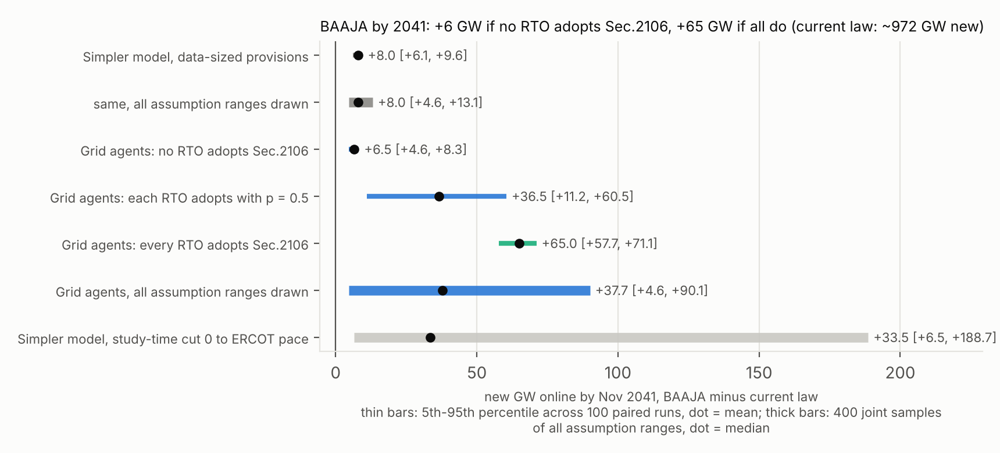
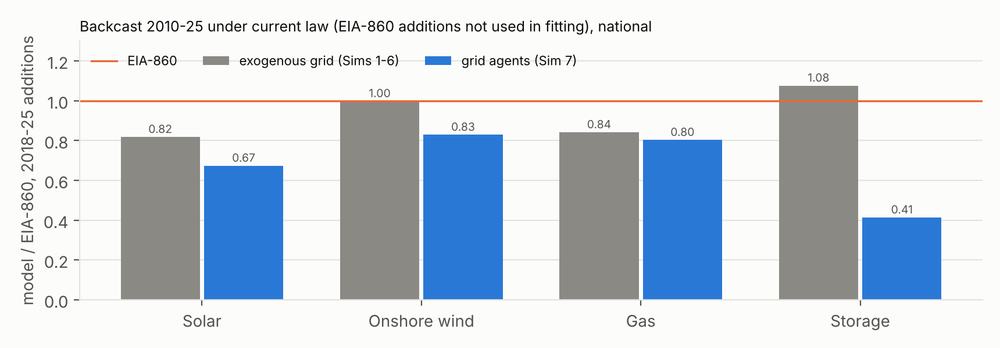

# What BAAJA would do to US electricity supply: an agent-based estimate

*Methods and results brief, 23 November 2026. Model, data and code: this repository. Full model description:
[`docs/ODD.md`](ODD.md). Section map of the bill: [`docs/bill_question_map.md`](bill_question_map.md).*

## Summary

- **Question.** How much would the Bipartisan American Affordability and Jobs Act (S.5653, passed by the Senate on
  19 November 2026 as a substitute to H.R. 2347) change how much generating capacity comes online in the United
  States, where, and whether regions meet their planning reserve margins?
- **Answer.** By November 2041 BAAJA adds about **+32 GW** of new capacity [5th-95th percentile +14 to +53] to the
  roughly 910 GW that comes online under current law in the agent-based model. Renewables are +19 GW, gas +8 GW and
  storage +4 GW. Across all assumption ranges drawn together, the interval is **+7 to +77 GW**.
- **What decides it.** Most of the gain is Sec.2106, the interconnection reform, and it depends on how many
  RTOs/ISOs change their process. If none do, the bill adds about +10 GW (permitting, courts and federal-land
  rights-of-way). If every RTO adopts it, +52 GW. The two most influential assumptions are the share of RTOs that
  adopt and how fast a cluster study can go under the reformed process.
- **Where.** The gain is in RTO markets, mostly MISO (+12 GW) and PJM (+7 GW). ERCOT, the Southeast and most of the
  West get only the permitting gains, because Sec.2106 in the Senate-passed text applies only to RTOs/ISOs.
- **Adequacy.** Under current law the national shortfall below NERC reference margins grows to about 71 GW in 2035
  and 137 GW in 2041, almost all of it in PJM, with CAISO from the early 2030s. BAAJA reduces it by about 2 GW in
  2035 [0 to 4] and 5 GW in 2041. **The bill does not close the adequacy gap**; demand growth and retirements matter
  far more than anything in it.
- **Compared with published estimates.** This is at the low end of what has been published (Rhodium 17-249 GW of
  additional clean capacity by 2040, RFF about 60 GW by 2028). The main reason is that those models remove
  interconnection limits by assumption, while this one models the queue that Sec.2106 changes and lets it decide.



## 1. The bill and the question

BAAJA is a permitting and transmission bill. The provisions that bear on generating capacity fall into four groups
(full map, with each section's status, in `docs/bill_question_map.md`):

| group | main sections | what changes |
|---|---|---|
| Permitting | 1101-1106 (NEPA deadlines and page limits), 2213 (federal-land rights-of-way deadlines), 1203-1204 (water permits) | months to a federal permit |
| Courts | 1301-1303 (150-day limit to sue, comment exhaustion, remedies) | how many suits are filed and how many halt a project |
| Permit certainty | 1401 | whether a permit can be revoked or suspended after issue |
| Grid access | 2106 (interconnection reform in RTOs/ISOs), 2110 (study capacity), 2101-2103, 2109, 2214 (transmission) | who enters the interconnection queue, who leaves it, how long studies take, how much hosting room the grid has |

The model asks how much capacity comes online by region and year with and without the bill, and what that does to
each region's reserve margin. It does not estimate prices, emissions or bills.

## 2. The model

Short version; the full description in standard ODD form (Grimm et al. 2020) is in `docs/ODD.md`.

- **Projects.** Every generation and transmission project requested from 2026 to 2041, plus the queue standing at
  the end of 2025, is drawn from LBNL interconnection-queue data by technology and region. Each goes through
  federal permitting (if it has a federal hook), possible litigation, possible federal halt, interconnection and
  construction. Permitting and litigation are sized from CEQ, BLM, Army Corps and NEPA-litigation data.
- **Grid operators (agents)**, one per region. They study requests in clusters (ERCOT one at a time) with a
  throughput fitted to LBNL request-to-agreement times, and allocate network-upgrade costs that rise as capacity is
  signed and fall as transmission is built.
- **Developers (agents).** They enter on the published wait and on their region's projected capacity shortfall.
  At each study result they compare the allocated upgrade cost with the project's private value (both from LBNL
  cost data) and stay or leave. They also leave over time at fitted background rates.
- **Supply.** What comes online is added to the EIA-860 fleet, less announced and age-based retirements, and
  compared with NERC's 2025 peak-demand forecast and reference margin levels, using on-peak capacity shares by
  technology.
- **The bill as mechanisms, not dials.** Sec.2106 becomes published interconnection locations with a fixed per-MW
  fee (no upgrade-cost shock at study results, no re-study cascade), a single decision point, and withdrawal
  penalties that discourage speculative requests. Each RTO adopts it with probability 0.5 in the central case.
  Sec.2110 is a study-throughput multiplier (0 in the central case, because the bill does not size it). Sec.2109
  adds hosting room per transmission line finished after the rule.
- **Paired runs.** Each bill scenario is run against current law with the same random numbers, so differences come
  from the bill, not from noise. 100 runs per scenario; 400 joint samples of every assumption range for the
  uncertainty analysis.

There is also a simpler version of the model (Sims 1-6) in which interconnection time is drawn from the historical
distribution instead of coming out of an agent-based queue. Its results are shown alongside as a check.

## 3. Data

All inputs are public. Sources, retrieval dates and file hashes: `data/SOURCES.md`.

- Interconnection: LBNL *Queued Up* (requests through 2025) and LBNL interconnection-cost studies; MISO and CAISO
  queue files.
- Permitting: CEQ EIS timelines, BLM MLRS rights-of-way cases, Army Corps permit data.
- Courts: 1,821 NEPA cases 2001-22; Sabin Center renewable-opposition database.
- Fleet, retirements, generation: EIA-860 (2015-2025), EIA-860M, EIA-923.
- Demand and adequacy: NERC 2025 Long-Term Reliability Assessment; PJM ELCC class ratings.

## 4. Results

### Nationally

| scenario (grid agents, 100 paired runs) | renewable GW | gas GW | storage GW | total GW by Nov 2041 |
|---|---|---|---|---|
| BAAJA | +18.6 [+7.0, +31.0] | +8.1 [+1.3, +16.2] | +3.5 [+0.8, +5.9] | **+32.0 [+13.6, +52.8]** |
| BAAJA without Sec.2106 | +5.3 | +1.0 | +1.7 | +9.8 [+7.7, +11.9] |
| BAAJA, every RTO adopts Sec.2106 | +30.2 | +15.0 | +4.7 | +51.6 [+45.9, +57.7] |
| BAAJA without Sec.2109 hosting room | +15.5 | +7.3 | +1.9 | +26.5 [+7.5, +45.5] |
| BAAJA + Sec.2110 study throughput +25% | +25.7 | +10.9 | +6.7 | +45.1 [+31.1, +61.0] |

Current law in the agent-based model: 910 GW [895, 926] of new capacity online by November 2041. The simpler model
has 1,105 GW, because there study results never remove projects whose upgrade costs exceed their value.

- The provisions that do not depend on the grid (permitting, courts, permit certainty, rights-of-way) add about
  **+10 GW**, mostly renewables. The largest single one is Sec.2213, the federal-land rights-of-way deadlines
  (+3.9 GW, all renewable). Its 30- and 90-day clocks have no enforcement, so how often they are met is a range.
- The court changes cut suits against energy projects by about 70% but add under 1 GW, because few suits ever halt
  a project. After the Supreme Court's *Seven County* decision (May 2025) narrowed NEPA review, they may be worth
  less still (+0.2 to +0.5 GW).
- Requests from before the reform keep their old terms, and projects requested after enactment take four to five
  years to reach operation. So **almost nothing changes before 2030**: firm capacity is +0.3 GW in 2030.

### By region


The gain is where Sec.2106 applies and where queues are most congested. In MISO the reform removes speculative
requests (about 83 fewer a year, out of 571), shortens studies by about 3 months and lifts the share of requests
that sign an agreement. ERCOT, the Southeast and the West gain only from permitting (about 1-2 GW each).

### Adequacy


Under current law, firm capacity falls behind NERC's reference margins in PJM from about 2028 and in CAISO from the
early 2030s. PJM's required margin rises to 35% as more of its supply is wind, solar and batteries, and its demand
forecast grows fast. The national shortfall reaches about 71 GW in 2035 and 137 GW in 2041 with grid agents.

BAAJA reduces the shortfall by 1.8 GW in 2035 [0 to 3.6] and 5.1 GW in 2041. If every RTO adopts Sec.2106, by
3.1 GW and 8.6 GW. That is a few percent of the gap. The shortfall is driven by demand growth (half or one and a
half times NERC's forecast growth gives 28 to 120 GW in 2035) and by how much on-peak credit wind, solar and
batteries get (51 to 91 GW), not by the bill.

The model has no capacity market or state procurement that would bid new entry in when margins fall. Developers do
respond to projected shortfalls when deciding to enter, but the queue limits how much gets through. The shortfall
should be read as pressure on those mechanisms, not as a forecast of outages.

## 5. What drives the result


Rank regression over 400 joint samples of every assumption range:

- **Without the grid agents**, the share of Sec.2213 deadlines that are met explains 46% of the variance. That
  result is narrow anyway: +10 GW [+6, +15].
- **With the grid agents**, the two Sec.2106 assumptions dominate: the minimum cluster-study time under the reformed
  process (19%) and the share of RTOs that adopt (17%), then Sec.2109 hosting room (9%) and Sec.2110 throughput
  (5%). The result: +31 GW [+7, +77].
- **Where Sec.2106 is a dial** (a percentage cut in study time, from none to ERCOT's pace) instead of a modelled
  process, the dial alone explains 76% and the range is +8 to +190 GW. That range is how uncertain the bill's
  effect is if nothing is known about how the reform works. Modelling the mechanism narrows it by more than half.

## 6. Validation



- **Backcast 2010-25.** Run under the law of the time from the 2010 queue, the model is compared with EIA-860
  additions in 2018-25, which it is not fitted to. The simpler model gets wind and storage right and is 16-18% low
  on solar and gas. The agent-based model is 19-33% low on solar, wind and gas, and 58% low on storage. The storage
  and solar gap is timing: in the agent-based model, 2020-22 storage and solar requests take 62-66 months from
  request to operation (39-60 in the simpler model), so many finish after 2025. Most of the gap is in CAISO and
  ERCOT.
- **Grid operators.** Fitted to 2010-19 request cohorts, then tested on 2020-24 cohorts held out. MISO's study times
  grew from about 20 to about 50 months, and the model reproduces this out of sample (45 vs 51 and 48 months for
  the 2020-21 cohorts), along with ERCOT's faster pace. Regions without reliable agreement dates use a pooled fit,
  which fits PJM, SPP and the West poorly.
- **Developers.** Withdrawal by 12, 36 and 60 months after request is fitted by region in the backcast. Months from
  request to operation are longer than LBNL's for completed projects (wind 64 vs 52, gas 48 vs 37).

The backcast fit is national. Regional additions are less reliable, and the agent-based model's lower current-law
total (910 vs 1,105 GW) is partly this under-prediction.

## 7. Comparison with published estimates

| study | model | bill text | headline | how interconnection is treated |
|---|---|---|---|---|
| **This brief** | agent-based queue + permitting and courts pipeline | Senate-passed (19 Nov) | +32 GW by 2041 [+14, +53]; +10 GW without Sec.2106 | operators and developers modelled; Sec.2106 only in RTOs, adoption uncertain |
| Rhodium Group (2 Nov 2026) | RHG-NEMS, capacity expansion | as introduced | 17-249 GW more clean capacity through 2040, mid case 56 GW | "we reduce barriers in the existing interconnection process", low/mid/high cases |
| Resources for the Future (29 Oct 2026) | ReEDS, capacity expansion | as introduced | about 60 GW more clean capacity by 2028; transmission about +30% by 2041 | baseline interconnection limits and wind executive-action impediments removed in policy cases |
| SEIA (Nov 2026) | not published | not stated | 167 GW more solar, 2028-35 | not stated |

Why this estimate is lower:

1. **Interconnection is an assumption there and an outcome here.** RFF removes its baseline interconnection limits
   in the policy cases; Rhodium reduces barriers by a chosen amount. Both then let a cost-minimising
   capacity-expansion model build what is cheapest. Here, Sec.2106 changes the rules of a queue, and how much more
   gets through depends on how many RTOs adopt, how fast reformed studies go and how many developers then enter.
   When this model is run with a pure study-time cut instead, it spans +8 to +190 GW, close to Rhodium's range.
2. **Scope of Sec.2106.** The Senate-passed text applies Sec.2106 only to RTOs/ISOs, and FERC may find existing
   processes already compliant (2106(d)). ERCOT, the Southeast and most of the West, about half of current-law
   additions here, are outside it. The published estimates used the introduced text.
3. **Timing.** RFF's 60 GW arrives by 2028. In this model, projects requested after enactment need four to five
   years to reach operation and standing requests keep their old terms, so the gain before 2030 is close to zero.
   RFF's result is closer to what removing the queue constraint would allow at once than to what the bill's
   process changes deliver in that time.
4. **Transmission.** Rhodium projects 1.9-2.6 TW-miles a year of transmission under the bill, against 0.7
   historically, and both models let that new capacity carry new generation. Here transmission permitting is
   faster and Sec.2109 adds hosting room (+5.5 GW of the +32), but no new transmission is planned in response to
   the bill.

Where the estimates agree: the permitting and court provisions alone are small, and the bill's effect on supply is
mostly about interconnection and transmission. CATF's critique of the permit-certainty provisions (a stop-work
exception in Sec.1401 may still allow near-term actions against permitted projects) matches the residual halt risk
assumed here, which leaves Sec.1401 worth only +0.3 to +0.7 GW.

## 8. Limits

- **Sec.2106 adoption and pace are assumptions.** No RTO has run the reformed process, so the adoption share
  (central 0.5) and the minimum study time are ranges, and together they explain over a third of the variance.
- **No capacity expansion or prices.** Developers enter on waits and projected shortfalls, not on prices. The model
  cannot say what BAAJA does to bills or emissions, and it does not let capacity markets fill the shortfall.
- **Demand is NERC's forecast with a range.** The bill's data-center provisions (2107, 2114, 2117) are listed, not
  modelled.
- **Transmission is not planned endogenously.** Only lines already in the queue are faster; Sec.2101-2104 planning
  reforms are listed.
- **Backcast is national.** The agent-based model under-predicts 2018-25 additions, most for storage.
- **Courts after *Seven County* are an assumption range**; no case data after 2022 were available.
- **Withdrawal penalty timing** (`lag_2106`) has no measurable effect on GW in the current model.
- **Suit counts differ** between the agent-based model (185 current-law suits) and the simpler model (119), because
  more projects stay in the queue longer.
- **Bill version.** The Senate-passed text, which may change in the House.

## 9. Reproducibility

```bash
pip install -r requirements.txt
```

```bash
python run.py --all --runs 100
```

```bash
python run.py --uncertainty 400
```

```bash
python run.py --brief-figures
```

```bash
python -m pytest -q
```

`--all` recalibrates, runs the 2010-25 backcast and all seven simulations, and writes `results/*.md|json` and
`figures/`. Runs are seeded, so the same commands reproduce the committed results. Every parameter is tagged in
`baaja/params.py` as data (with source) or assumption (with range). Raw downloads are not committed; extractors in
`data/` rebuild the JSON summaries from them, and `data/SOURCES.md` lists where each file comes from.

## Sources for the comparison

- Rhodium Group, *BAAJA: US energy system impacts*, 2 Nov 2026: rhg.com/research/baaja-us-energy-system-impacts/
- Resources for the Future, *Projected effects of the Bipartisan American Affordability and Jobs Act on the power
  sector*, 29 Oct 2026: rff.org/publications/issue-briefs/projected-effects-of-the-bipartisan-american-affordability-and-jobs-act-on-the-power-sector/
- SEIA, *BAAJA impact on the electricity sector*: seia.org/research-resources/baaja-impact-on-the-electricity-sector/
  (as reported by TaiyangNews, 20 Nov 2026)
- Clean Air Task Force, 12 Nov 2026: catf.us/2026/11/even-after-managers-amendment-baajas-permitting-certainty-provisions-may-not-prevent-near-term-actions-stop-clean-energy-projects/
- NRDC assessment: nrdc.org/media/nrdc-assessment-baaja-2026-permitting-transmission-bill
- Congressional Research Service, R49510: congress.gov/crs-product/R49510
- Grimm, V. et al. (2020). The ODD protocol for describing agent-based and other simulation models: a second update.
  *Journal of Artificial Societies and Social Simulation* 23(2) 7.
