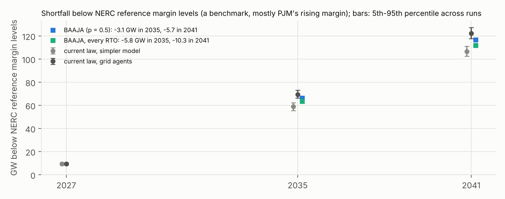
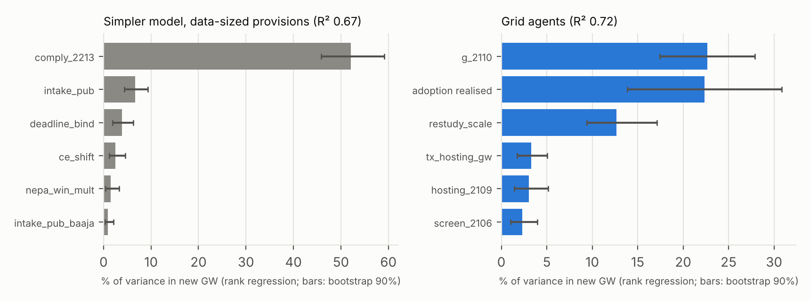

# What BAAJA would do to US electricity supply: a simulation of permitting, courts and the interconnection queue

*Methods and results brief, 24 November 2026. Model, data and code: this repository. Full model description:
[`docs/ODD.md`](ODD.md). Section map of the bill: [`docs/bill_question_map.md`](bill_question_map.md).*

## Summary

The Bipartisan American Affordability and Jobs Act (BAAJA) was introduced as S.5653 on 30 September 2026 and adopted
with changes as S.Amdt. 6883 to H.R. 2347, which the Senate passed on 19 November 2026 by 62 to 33. This brief asks
how much generating and storage capacity the Senate-passed text would bring online in the United States by 2041,
in which regions, and what that does to regional reserve margins.

By November 2041 the bill adds 6.7 GW of new capacity if no RTO/ISO changes its interconnection process under
Sec.2106, and 37.0 GW if every one does, against about 954 GW that comes online under current law. With each RTO
changing its process with probability one half, the result is 21.9 GW [5th-95th percentile 7.5 to 37.2] across 100
paired runs; that interval mostly reflects which RTOs happen to change, and the one-half probability is an
assumption, not an estimate. Of the 21.9 GW, 14.9 GW are renewables, 5.0 GW gas and 2.0 GW storage. Relicensed hydro
returning to service sooner adds a further 1.8 GW and is not counted as new capacity.

The size of the Sec.2106 effect rests on assumed parameters. The two that matter most are whether an RTO's process
actually changes (FERC may find existing processes compliant under Sec.2106(d)) and how many requests the
non-refundable security and withdrawal penalties keep out. If they keep out half of new requests instead of a
quarter, Sec.2106 adds nothing. How the screen is specified matters too: I first specified it as an absolute
threshold on each request's chance of completing, and under that version the bill reduces capacity by 2 GW. I
changed to the relative version after seeing those results (section 2), and report both. Drawing every assumption
range together gives a median of 26.5 GW [4.9, 64.0].

Little changes before the early 2030s. The model assumes reformed interconnection studies start about three years
after enactment (range two to four; the bill gives FERC 18 months for the rule and RTOs two years to file), and that
requests already in the queue keep their current terms. By 2030 the bill has added 0.3 GW; by 2035, 10.8 GW.

The gain is concentrated in MISO, with 12.4 of the 21.9 GW. PJM gains almost nothing, because in PJM the modelled
entry screen keeps out requests that would have completed (section 4.3). ERCOT is outside FERC jurisdiction and the
Southeast and non-ISO West have no RTO, so Sec.2106 does not reach them; they gain from permitting and from Sec.2109,
which applies to all public-utility transmission providers.

Under current law the national shortfall below NERC's Reference Margin Levels reaches about 69 GW in 2035 and 122 GW
in 2041, most of it in PJM, where NERC's margin rises from 18.6% to 35.1%. BAAJA reduces the 2035 shortfall by 3.1 GW
[0.3, 6.4]. The shortfall is a benchmark against NERC's planning margins, not a forecast of outages, and the bill
does not close it.

The bill's gain in clean capacity here, 16.9 GW of renewables and storage by November 2041, is at the low end of
Rhodium Group's 17 to 249 GW through 2040 and well below Resources for the Future's figure of about 60 GW by 2028.
The difference has several sources that cannot be separated from outside: both studies expand transmission under
the bill and this model does not plan any; RFF attributes its near-term gain mainly to permit certainty; and each
study, including this one, sets the extent of interconnection relief by assumption.


## 1. The bill and the question

BAAJA is a permitting and transmission bill. The provisions that bear on generating capacity fall into four groups
(full map, with each section's status, in `docs/bill_question_map.md`):

| group | main sections modelled | what changes in the model |
|---|---|---|
| Permitting | 1105-1106 and 1108 (level of review; one-year EA and two-year EIS deadlines), 1202 (one-year Clean Water Act s.401 clock), 1302 (ESA consultation timeline), 2213 (federal-land rights-of-way clocks), 2229 | months to a federal permit |
| Courts | 1110 and 2201 (150-day limit to sue, comment exhaustion, remand without vacatur); 1134, 1205 and 1305 extend the same limits to other statutes | how many suits are filed and how many halt a project |
| Permit certainty | 1401 | whether a permit can be revoked or suspended after issue |
| Grid access | 2106 (interconnection reform in RTOs/ISOs), 2110 (study automation), 2109 (advanced transmission technologies), 2101, 2102(a) and 2214 (transmission permitting) | who enters the interconnection queue, who leaves it, how long studies take, how much hosting room the grid has |

Sections 1203 and 1204 (NPDES permit term and Clean Water Act s.404) are listed but not modelled, because they act
on existing plants and on wetlands permits the model cannot attach to generation projects.

The model asks how much capacity comes online by region and year with and without the bill, and what that does to
each region's reserve margin. It does not estimate prices, emissions or customer bills.

Several provisions that bear on supply are outside the model. Sec.2107(b) lets states condition retail service to a
data center on new generation it procures, which acts on the demand behind the adequacy gap. Sec.2108 bars RTOs from
blocking behind-the-meter aggregations (5 kW to 5 MW of storage, fuel cells and generators) from wholesale markets,
which is capacity outside the interconnection queue. Sec.2102(b) exempts interstate gas pipeline looping and
compression in existing corridors from NEPA review. Sec.2109 also requires utilities to evaluate and deploy advanced
technologies on existing lines; the model credits only extra hosting room on lines finished after the rule.
Sec.2103 (mandatory regional and interregional planning with cost allocation) is the bill's main mechanism for
building transmission, and the model does not plan transmission. Sec.1501-1504 (nuclear licensing) are listed
because no new reactor reaches operation through the queue data by 2041.

## 2. The model

The full description, in the ODD form of Grimm et al. (2020), is in `docs/ODD.md`. In short, it is a model of the
interconnection queue with decision rules for grid operators and developers, coupled to a permitting and litigation
pipeline and to a supply-and-adequacy account.

Projects. Every generation, storage and transmission request from 2026 to 2041, plus the queue standing at the end
of 2025, is drawn from LBNL interconnection-queue data by technology and region (Rand et al. 2026). Each goes through
federal permitting if it has a federal hook, possible litigation, possible federal halt, interconnection and
construction. Permitting and litigation are sized from CEQ, BLM, Army Corps and NEPA-litigation data.

Grid operators, one per region, study requests in clusters (ERCOT one at a time) with a throughput fitted to LBNL
request-to-agreement times. They allocate network-upgrade costs drawn from LBNL's regional cost studies; costs rise
with the capacity signed in a region (by a rate fitted to LBNL cost data for requests made since 2018 against 2010-17; zero in ERCOT, which does not allocate network upgrades to generators) and fall as transmission is finished.

Developers enter on the published wait and on their region's projected capacity shortfall. At each study result they
compare the allocated upgrade cost with the project's private value (both from LBNL cost data) and stay or leave.
They also withdraw over time at background rates fitted by region.

Supply. What comes online is added to the EIA-860 fleet, less announced and age-based retirements, and compared with
NERC's 2025 peak-demand forecast and reference margin levels, using NERC's on-peak capacity shares by technology
(on-peak accredited capacity below).

The bill enters as mechanisms. Under Sec.2106 a reformed RTO publishes interconnection locations with an upfront,
fixed per-MW fee set at the region's expected upgrade cost (so the requests using them face no cost shock at the
study result and no re-study), holds a single decision point, and requires non-refundable security and withdrawal
penalties, which the model represents as an entry screen. Within each technology and region, the quarter of new
requests least likely to complete (range a tenth to a half) do not enter; requests using a published location are
exempt. Johnston, Liu and Yang (2023, revised 2026) find that higher queue-entry costs deter speculative requests
with little change in the capacity that completes, which is what a screen on the least likely requests implies.
Each RTO's process changes with probability 0.5 in the central case.

The screen was first specified as an absolute threshold: requests whose modelled chance of completing was below
0.25 did not enter. After the calibration was refitted, that threshold kept out nearly all new storage requests in PJM.
The refit had put developer values for storage in PJM, SPP and ERCOT, solar in SPP and offshore wind at the bottom of
their allowed range, where few requests clear an absolute threshold.
The threshold's units moved with the calibration, so I changed the specification to the relative screen after seeing
those results. The absolute version is reported as a sensitivity in section 4. Sec.2110 is a study-throughput
gain, zero in the central case because the bill sets no target. Sec.2109 adds hosting room per transmission line
finished after the rule.

Each bill scenario is run against current law with the same random numbers, so differences come from the bill and
not from sampling noise. There are 100 paired runs per scenario and 400 joint Latin-hypercube samples of every
assumption range for the uncertainty analysis (Saltelli et al. 2008).

A simpler version of the model (Sims 1-6) draws interconnection time from the historical distribution instead of
from the queue. Its results appear alongside as a check and are labelled as such.

## 3. Data

All inputs are public. Sources, retrieval dates and file hashes are in `data/SOURCES.md`.

- Interconnection: LBNL *Queued Up* workbook (requests through 2025) and LBNL interconnection-cost studies for MISO,
  PJM, SPP, NYISO and ISO-NE. The CAISO, MISO and NYISO queue files were downloaded for cross-checks but are not
  used.
- Permitting: CEQ EIS timelines, BLM MLRS rights-of-way cases, Army Corps permit data.
- Courts: 1,821 NEPA cases decided 2001-22; Sabin Center renewable-opposition database.
- Fleet, retirements and generation: EIA-860 (2015-2025), EIA-860M, EIA-923.
- Demand and adequacy: NERC 2025 Long-Term Reliability Assessment; PJM ELCC class ratings.
- Bill text: the Senate floor copy of S.Amdt. 6883 (KAT26804 V62), checked against the engrossed Senate amendment to
  H.R. 2347 (GovInfo, BILLS-119hr2347eas). Every modelled section is identical word for word.

## 4. Results

All numbers in this section are from the grid-agent model (Sim 7, `results/sim7_grid_agents.json`): means across
100 paired runs, with the 5th and 95th percentiles in brackets, for capacity online by November 2041. New capacity
excludes relicensed hydro, which is reported separately.

### 4.1 How much, and under which assumption about Sec.2106

| scenario | new capacity GW | renewables GW | gas GW | storage GW |
|---|---|---|---|---|
| BAAJA, no RTO changes its process (Sec.2106 off) | +6.7 [+5.0, +8.8] | +4.8 | +0.9 | +1.1 |
| BAAJA, each RTO changes its process with probability 0.5 (central) | +21.9 [+7.5, +37.2] | +14.9 | +5.0 | +2.0 |
| BAAJA, every RTO changes its process | +37.0 [+32.0, +42.8] | +24.7 | +9.2 | +3.1 |
| BAAJA, central, plus a 25% study-throughput gain under Sec.2110 | +37.4 [+26.1, +49.3] | +23.3 | +8.4 | +5.8 |

Current law brings about 954 GW of new capacity online by November 2041 [939, 972]. The bill adds 2% to 4% to that,
depending on how many RTOs change their process. The first row, which keeps every provision except Sec.2106, contains
Titles I and II (permitting and courts), Sec.2109 and Sec.2110 at zero; Sec.2109's extra hosting room adds about 4 GW
to the central case (+17.8 GW without it). Relicensed hydro that returns to service sooner adds a further 1.8 GW in
every bill scenario.

The interval on the central row is wide because it mostly records which RTOs happen to change their process in each
run. The two rows around it bound it, and the probability of one half is an assumption: Sec.2106(d) lets FERC find an
existing process compliant, and nothing in the record says how often it will. The simpler model, with study times
drawn from history and Sec.2106 and Sec.2110 set to zero, gives +8.0 GW [+6.1, +9.6] for the same bill, close to the
first row.

### 4.2 When

| year (to November) | current law: new GW that year | BAAJA central: cumulative GW vs current law | no RTO changes | every RTO changes |
|---|---|---|---|---|
| 2028 | 91 | +0.0 | +0.0 | +0.0 |
| 2030 | 114 | +0.3 | +0.3 | +0.3 |
| 2032 | 56 | +0.6 | +0.6 | +0.6 |
| 2033 | 62 | +2.3 | +1.1 | +3.3 |
| 2035 | 53 | +10.8 [+3.4, +18.4] | +1.9 | +18.8 |
| 2038 | 48 | +17.0 | +4.0 | +29.7 |
| 2041 | 44 | +21.9 | +6.7 | +37.0 |

The bill adds under 1 GW before 2033. The permitting and court provisions add a little each year from the start.
Sec.2106 applies only to requests made after the rule takes effect (late 2029 in the central case), and the first of
those come online in 2033. Current-law additions peak at 118 GW in 2029, while the queue standing at the end of 2025
is being built, then settle around 45 to 60 GW a year.

### 4.3 Where


Of the 21.9 GW in the central case, 12.4 GW is in MISO; if every RTO changes its process, MISO gains 23.5 of the 37.0
GW. ERCOT, the Southeast and the non-ISO West gain 0.5 to 1.9 GW each from the provisions that apply everywhere.

PJM gains almost nothing from Sec.2106: 0.5 GW in the central case and 0.7 GW if every RTO changes its process, the
same as with Sec.2106 off. If every RTO changes its process, Sec.2106 does shorten PJM's studies (from 30 to 28 months to
agreement) and raise the share of requests that sign, but the entry screen offsets it. The screen keeps out the requests least likely to complete as
ranked by their private value. In PJM, whether a request completes depends more on its upgrade-cost draw than on its
value: 13.7% of PJM requests in LBNL's cost study pay no network upgrade, and PJM's cost spread is the widest of the
regions with LBNL cost studies. So in PJM the screen also keeps out requests that would have completed. In a diagnostic run
without the screen, PJM gains from Sec.2106 as MISO does. This is a property of the modelled screen, which treats a
deposit as screening on value, and a deposit that screened on cost information would behave differently.

### 4.4 The entry screen

| entry screen | current law GW | BAAJA central vs current law | every RTO changes |
|---|---|---|---|
| Sec.2106 keeps out the bottom quarter within technology and region (central) | 956 | +17.4 | +37.3 |
| as above, and current law already screens out a tenth (Order 2023 deposits) | 957 | +19.4 | +39.8 |
| Sec.2106 keeps out requests whose chance of completing is below 0.25 (previous specification) | 956 | -2.2 | -4.6 |

These rows use 20 paired runs each, so the central case is +17.4 GW instead of +21.9 GW with 100 runs; the difference
is which RTOs adopt in the smaller sample. Assuming current law already screens out a tenth of requests, as Order
2023's readiness deposits may, raises the bill's effect slightly, because fewer marginal requests are left for
Sec.2106 to remove. Under the previous, absolute specification the bill reduces capacity, because the screen removes
most storage requests in regions where the fitted developer value is at its lower bound (section 2). Which
specification is right is not something the data here can settle, and the result depends on it.

A stricter relative screen also matters: keeping out half of new requests instead of a quarter brings the central
case to +6.4 GW, below the +7.3 GW with Sec.2106 off in the same 20 runs, so a strict enough screen cancels the rest of
Sec.2106. Keeping out a tenth gives +21.0 GW.

### 4.5 Adequacy



The adequacy account compares on-peak accredited capacity with NERC's 2025 peak-demand forecast plus each region's
Reference Margin Level, the reserve margin NERC uses as its planning benchmark. Under current law the national
shortfall below those levels is 9 GW in 2027, 69 GW [66, 73] in 2035 and 122 GW [118, 127] in 2041. In 2035, 57 GW of
the shortfall is in PJM, whose Reference Margin Level, as an installed-capacity margin, rises from 18.6% in 2026 to
35.1% in 2034 as accreditation of new resources falls; CAISO (7 GW) and MISO (5 GW) account for most of the rest.

BAAJA reduces the 2035 shortfall by 3.1 GW [0.3, 6.4] in the central case and by 5.8 GW if every RTO changes its
process; by 2041 the reductions are 5.7 and 10.3 GW. The bill does not close the gap. Most of the shortfall is in PJM,
where the bill adds little (section 4.3). The simpler model, with historical study times (Sim 6,
`results/sim6_supply.md`), shows MISO and ISO-NE first falling below their margins in 2027 (median first year across
runs) and staying close to them: in 2035 MISO's reserve margin is 8.4% against a Reference Margin Level of 8.9%, and
ISO-NE's 11.8% against 13.0%, below the level in 66% and 71% of runs.

These figures are a benchmark against planning margins. They are not a forecast of outages: apart from developers entering faster where a shortfall is projected,
the model has no response from prices, no demand response beyond NERC's forecast and no delayed retirements, all of
which narrow a shortfall in practice.

Under the joint uncertainty analysis below, the 2035 shortfall reduction is 2.0 GW [0.1, 8.8] (median, 5th-95th
percentile across 400 samples).

## 5. What drives the result

Two analyses answer this. The first moves one assumption at a time to the low and high end of its range, holding the
others central (20 paired runs each, `results/sim7_grid_agents.json`, central case +17.4 GW in these runs). The second
draws every assumption at once, 400 Latin-hypercube samples, and splits the variance of the result by rank regression
(`results/uncertainty.json`).

| assumption (range) | BAAJA minus current law, new GW, low / high |
|---|---|
| probability an RTO changes its process (0 / 1) | +7.3 / +37.3 |
| Sec.2110 study-throughput gain (0 / 25%) | +17.4 / +34.8 |
| Sec.2109 hosting room per new line (0 / 30%) | +13.3 / +25.8 |
| share of requests the entry screen keeps out (0.5 / 0.1) | +6.4 / +21.0 |
| growth of upgrade cost with capacity signed (5.14 / 0) | +13.5 / +24.2 |
| months of re-study after the first result (3 / 12) | +13.3 / +24.2 |
| cost rise for remaining requests per withdrawn MW (0.1 / 0.6) | +13.6 / +21.5 |
| share able to use a published location (0.25 / 0.9) | +16.9 / +18.3 |
| fee as a multiple of expected upgrade cost (1.5 / 0.8) | +16.8 / +18.4 |

The bill's effect is most sensitive to the assumptions about how Sec.2106 and Sec.2110 are carried out, none of which
the statute sizes. Upgrade-cost growth (`kappa`) matters more for the level of current law than for the bill's
effect: at zero, current law brings 1,118 GW online, against 842 GW at the high end.



Drawing every range together gives a median of +26.5 GW [+4.9, +64.0] of new capacity. The median is above the
central +21.9 GW because the joint draw includes Sec.2110 gains above zero, while the central case sets them to zero.
Rank regression explains 67% of the variance. The largest share, 23% [14, 31], is how much of the RTOs' capacity sits
in RTOs that changed their process in that sample, followed by the Sec.2110 gain (12%), the screen's share (7%),
upgrade-cost growth (6%) and Sec.2109 hosting room (6%). Split by the adoption that happened, the median is +13.3 GW
when no RTO changed its process, +26.5 GW when some did and +39.3 GW when all did.

In the simpler model, with Sec.2106 and Sec.2110 at zero, the result is +8.0 GW [+4.6, +13.1], and 52% of its
variance comes from one assumption: the share of new applications for rights-of-way on federal land whose Sec.2213
intake deadlines are met. When that model's study-time cut for Sec.2106 is instead drawn from zero to ERCOT's pace, the range becomes
+33.5 GW [+6.5, +188.7], with 76% of the variance from that cut alone. That is the gap the grid-agent model was built
to close: it replaces an assumed cut in study time with operators and developers whose behavior is fitted to queue
data, and narrows the upper end from 189 to 64 GW.

## 6. Validation

The model was run from January 2010 to December 2025 under current law and compared with what happened
(`results/backcast.md`, `results/calibration.json`). It passes some tests and fails others, and the failures bear on
the result.

What was fitted, and to what. Grid operators' study throughput was fitted to LBNL request-to-agreement times for
2010-19 cohorts; CAISO, ERCOT and MISO have their own fit, and the other six regions, which lack reliable agreement
dates, use the pooled MISO and CAISO fit. Developers' background withdrawal rates were fitted to the shares of
2015-19 requests withdrawn by 12, 36 and 60 months in each region, three parameters for three targets. Developer
value scales were fitted to LBNL completion rates for 2010-19 requests by technology and region. The NEPA EIS
probabilities and overdue windows were refitted with the agents on, and the storage settings were chosen with the
backcast in view, so the backcast is not fully independent of the fit.

National additions, 2018-25 (EIA-860, not used in fitting). The agents produce 68% of EIA's solar additions (86.9 vs
127.2 GW), 82% of onshore wind, 80% of gas and 45% of storage (19.5 vs 43.1 GW). The simpler model with historical
study times does better (82%, 100%, 84% and 108%). Both miss the 2024-25 jump in solar (31 and 30 GW in EIA); the agents also miss the jump in storage. By region, the
weighted mean absolute log ratio of model to EIA additions is 0.51 for the agents and 0.42 for the simpler model;
MISO, where much of the Sec.2106 effect sits, has a ratio of 0.51, and storage in PJM is 3.9 GW in the model against
0.4 GW in EIA.


Completion by technology and region. All but one cell fits within a third of the LBNL rate. ERCOT storage completes
at 18.4% in the model against 11.7% in the data. Its value scale is at the lower bound of its range, and 17% of
ERCOT requests have no network-upgrade cost, so even the lowest value leaves too many completing. Five value scales
sit at that lower bound (solar in SPP; storage in ERCOT, PJM and SPP; offshore wind), so in those cells the fitted
value is a corner, not an estimate.

Withdrawal timing. In the fitted cohorts the 24-month shares, which were left out of the fit, differ from the data
by at most 0.05 in every region. The 2020-23 cohorts, used in no fit, are a different matter. The model's 12-month withdrawal shares are
0.59 in CAISO against 0.12 in the data, 0.30 in PJM against 0.13, 0.40 in NYISO against 0.72 and 0.09 in the West
against 0.33. The data's withdrawal rates for these cohorts differ from 2015-19 in both directions, and the model's
hazards, fixed at their 2015-19 values, do not follow them. The fitted hold after an adverse study result is at its
240-month upper bound in five of nine regions, which means the model finds no hold short enough to fit those regions'
60-month shares; it delays when a withdrawal is recorded rather than whether it happens.

Study times out of sample. MISO's lengthening from about 21 to 45 months, between the 2010 and 2019 cohorts, falls within the fitted
cohorts. For the
2020 and 2021 cohorts the model's median is 45 months against 51 and 48. Medians are censored at December 2025, so
the share signed by then is the cleaner test, and it misses: MISO's 2021 cohort is 62% signed in the model against
36% in the data, and ERCOT's 2020-23 cohorts 94%, 89%, 70% and 52% against 67%, 53%, 44% and 32%. The pooled fit
fits PJM poorly: 99% of its 2020 cohort signs in the model against 3% in the data, though only six PJM requests
from 2020 have an agreement date at all.

What follows for the result. The model underpredicts recent solar and storage additions, holds recent withdrawal
rates at their 2015-19 levels, and signs agreements faster than the 2020s queues did. The first makes current-law
additions too low; the other two work in opposite directions on how many requests reach a decision. The Sec.2106
effect is measured as a difference from the same current-law run, so these errors enter it through how many
requests are in the queue when the rule takes effect, and the uncertainty intervals do not include them.

## 7. Comparison with published estimates

| study | model | bill text | headline | how interconnection is treated |
|---|---|---|---|---|
| This brief | queue model with operator and developer rules, plus permitting and courts | Senate-passed (19 Nov) | 21.9 GW new capacity by Nov 2041 (6.7 if no RTO changes, 37.0 if all do); renewables and storage 16.9 GW | Sec.2106 only in FERC-jurisdictional RTOs; whether each changes its process, and how strictly it screens, are assumptions |
| Rhodium Group (2 Nov 2026) | RHG-NEMS, capacity expansion | as introduced | 17 to 249 GW more clean capacity through 2040 across its high-, mid- and low-emissions scenarios (technology costs, fuel prices); mid case 56 GW | "we reduce barriers in the existing interconnection process" |
| Resources for the Future (Rennert and Bergman, 29 Oct 2026) | ReEDS, capacity expansion | as introduced | about 60 GW more clean capacity in 2028; transmission about 30% above baseline in 2041 | baseline interconnection limits removed in the policy cases; results reported as robust to that representation |
| SEIA (10 Nov 2026) | not retrieved | not stated | 167 GW more solar, 2028-35 | not retrieved |

Comparing like with like, this model's gain in clean capacity (new renewables and storage) by November 2041 is
16.9 GW in the central case, against Rhodium's 17 to 249 GW through 2040. The difference has four
sources, and from the published material they cannot be separated.

1. Transmission. Rhodium projects 1.9 to 2.6 TW-miles of new transmission a year under the bill, against 0.9 to 1.9
   in its baseline and 0.7 in 2015-24, and RFF's transmission is about 30% above baseline by 2041. Both let new lines
   carry new generation. This model makes transmission already in the queue faster and adds Sec.2109 hosting room,
   but does not plan new lines in response to the bill (Sec.2103 is not modelled). This is a limit of this model.
2. Permit certainty. RFF attributes its 2028 gain mainly to "provisions intended to increase permitting certainty
   and consistency across administrations". In the simpler model here, Sec.1401 adds 0.3 to 0.7 GW of renewables.
   The difference is in the assumed baseline: RFF's current law includes executive actions that impede wind, which
   its policy cases remove; this model's current law has a residual risk of federal halts that Sec.1401 reduces.
   Rhodium did not model the permit-certainty provisions and calls its results conservative.
3. Interconnection. All three studies set the extent of interconnection relief by assumption: RFF removes its
   baseline limits, Rhodium reduces barriers by a chosen amount, and this model assumes which RTOs change their
   process and how strictly they screen. RFF reports that its results are robust to its interconnection
   representation, with the timing of the build-out shifting. Here, the interconnection assumptions are the largest source of uncertainty.
4. Scope and timing. The Senate-passed Sec.2106 reaches only RTOs/ISOs; both studies used the introduced text,
   which already excluded ERCOT but also covered the Southeast and the non-ISO West. Those two regions account for
   34% of current-law new capacity here (323 of 954 GW). The statute's own clock (rule in 18 months, filings in two years)
   makes a large interconnection effect by 2028 unlikely, whatever the model.

Neither published study estimates the NEPA and court provisions separately, so they neither confirm nor contradict
the small effect found for them here. The Clean Air Task Force (12 Nov 2026) argues that Sec.1401's
national-security exception, and the absence of a bar on agencies seeking voluntary remand of issued
authorizations, leave near-term risk to permitted projects. That points the same way as the residual halt risk
assumed here, though the model's residual rests on a different exception, 1401(F) (action "taken pursuant to any
applicable law or regulation").

SEIA's 167 GW of additional solar between 2028 and 2035 is about 19 times this model's solar gain by November 2041
(9.0 GW in the central case). SEIA's method page could not be retrieved, so the comparison stops at the figure.

## 8. Limits

The largest limit is that the Sec.2106 effect rests on two assumptions with no data behind them: whether each RTO's
process changes, and how many requests the non-refundable security and withdrawal penalties keep out. The entry
screen was also respecified after the first results were seen (section 2). Reading the result as a range across
those assumptions is safer than reading the central number.

The model plans no transmission. Sec.2103 (mandatory regional and interregional planning with cost allocation) is
the bill's main route to new lines, and both published studies credit the bill with more transmission. Upgrade
costs here rise with capacity signed and fall only as transmission already in the queue is finished and with Sec.2109's added hosting room, so the model
understates what the bill does if Sec.2103 works as intended.

Several fitted values are corners. Five developer value scales sit at the lower bound of their range, ERCOT storage
does not fit its completion rate, and the hold after an adverse study result is at its 240-month upper bound in five
regions. The NEPA EIS probabilities were refitted with the agents on, which ties the permitting side to the queue
side of the calibration. The backcast fails out of sample on withdrawal timing and on the share of requests signed
(section 6), and the uncertainty intervals do not include these errors.

Developers respond to upgrade costs, published waits and their region's projected shortfall, but not to prices,
tax credits or offtake contracts, so the model says nothing about how the bill interacts with federal tax credits or
power prices. Demand is NERC's 2025 forecast and does not respond to the bill;
Sec.2107(b) on data-center supply is outside the model. On-peak shares by technology are fixed at NERC's values,
although storage's accredited share falls as more storage is built.

Requests already in the queue when the rule takes effect keep the current process, because the new s.228 has no
transition clause; if FERC moved them into the reformed process, the effect would come sooner. The rule month (three
years after enactment, range two to four) is an assumption.

The model does not estimate prices, emissions, customer bills or reliability events. The shortfall below NERC's
reference margin levels is a planning benchmark.

## 9. Reproducibility

```bash
pip install -r requirements.txt
```

```bash
python run.py --all --runs 100
```

```bash
python run.py --uncertainty 400
```

```bash
python run.py --brief-figures
```

```bash
python -m pytest -q
```

`--all` recalibrates, runs the 2010-25 backcast and all seven simulations, and writes `results/*.md|json` and
`figures/`. Runs are seeded, so the same commands reproduce the committed results. Every parameter is tagged in
`baaja/params.py` as data (with source) or assumption (with range). Raw downloads are not committed; extractors in
`data/` rebuild the JSON summaries from them, and `data/SOURCES.md` lists where each file comes from.

## References

Clean Air Task Force (2026, 12 November). Even after manager's amendment, BAAJA's permitting certainty provisions
may not prevent near-term actions to stop clean energy projects.
https://www.catf.us/2026/11/even-after-managers-amendment-baajas-permitting-certainty-provisions-may-not-prevent-near-term-actions-stop-clean-energy-projects/

Grimm, V., Revilla, E., Berger, U., Jeltsch, F., Mooij, W.M., Railsback, S.F., Thulke, H.-H., Weiner, J.,
Wiegand, T. and DeAngelis, D.L. (2005). Pattern-oriented modeling of agent-based complex systems: lessons from
ecology. *Science* 310(5750): 987-991. https://doi.org/10.1126/science.1116681

Grimm, V., Railsback, S.F., Vincenot, C.E., Berger, U., Gallagher, C., DeAngelis, D.L., Edmonds, B., Ge, J.,
Giske, J., Groeneveld, J., Johnston, A.S.A., Milles, A., Nabe-Nielsen, J., Polhill, J.G., Radchuk, V.,
Rohwäder, M.-S., Stillman, R.A., Thiele, J.C. and Ayllón, D. (2020). The ODD protocol for describing agent-based and
other simulation models: a second update to improve clarity, replication, and structural realism. *Journal of
Artificial Societies and Social Simulation* 23(2): 7. https://doi.org/10.18564/jasss.4259

Johnston, S., Liu, Y. and Yang, C. (2023, revised November 2026). An empirical analysis of the interconnection
queue. NBER Working Paper 31946. https://doi.org/10.3386/w31946

Rand, J., Cheyette, A., Talley, C., Zhang, S., Gorman, W., Wiser, R.H., Seel, J., Jeong, S. and Kahrl, F. (2026).
*Queued Up: 2026 Edition. Characteristics of Power Plants Seeking Transmission Interconnection as of the End of
2025.* Berkeley, CA: Lawrence Berkeley National Laboratory. https://emp.lbl.gov/queues

Rennert, K. and Bergman, A. (2026, 29 October). Projected effects of the Bipartisan American Affordability and Jobs
Act on the power sector. Resources for the Future issue brief.
https://www.rff.org/publications/issue-briefs/projected-effects-of-the-bipartisan-american-affordability-and-jobs-act-on-the-power-sector/

Rhodium Group (2026, 2 November). BAAJA: US energy system impacts.
https://rhg.com/research/baaja-us-energy-system-impacts/

Saltelli, A., Ratto, M., Andres, T., Campolongo, F., Cariboni, J., Gatelli, D., Saisana, M. and Tarantola, S.
(2008). *Global Sensitivity Analysis: The Primer.* Chichester: Wiley. https://doi.org/10.1002/9780470725184

SEIA statement of 10 November 2026, as reported by Ludt, B. (2026, 10 November), Senate advances federal energy
permitting bill, *Solar Power World*,
https://www.solarpowerworldonline.com/2026/11/senate-advances-federal-energy-permitting-bill/ ; Willis, B. (2026,
10 November), US permitting bill moves forward as opposition grows, *PV Tech*,
https://www.pv-tech.org/us-permitting-bill-moves-ahead-environment-opposition-grows/ ; and Bhambhani, A. (2026,
20 November), US BAAJA permitting bill could unlock 167 GW of solar, *TaiyangNews*,
https://taiyangnews.info/markets/us-baaja-permitting-bill-could-unlock-167-gw-solar

Windrum, P., Fagiolo, G. and Moneta, A. (2007). Empirical validation of agent-based models: alternatives and
prospects. *Journal of Artificial Societies and Social Simulation* 10(2): 8. https://www.jasss.org/10/2/8.html
