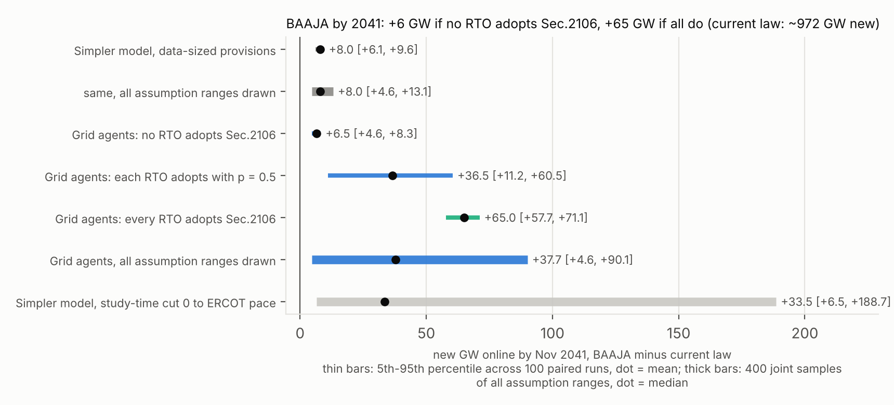
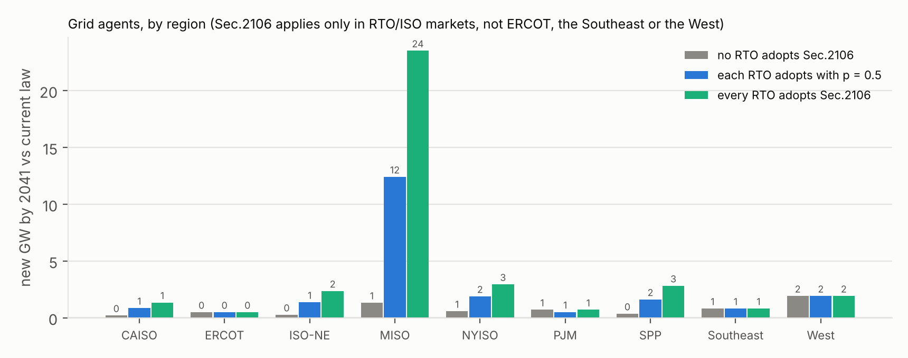
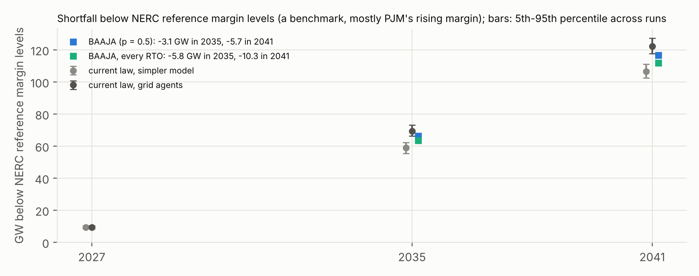
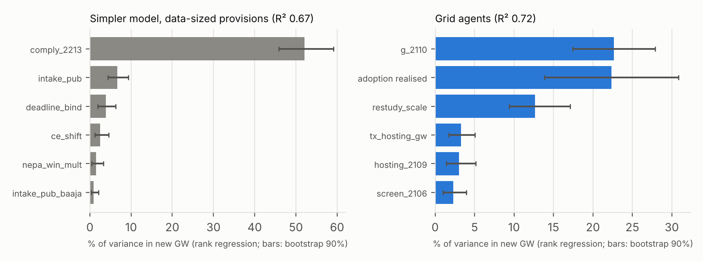
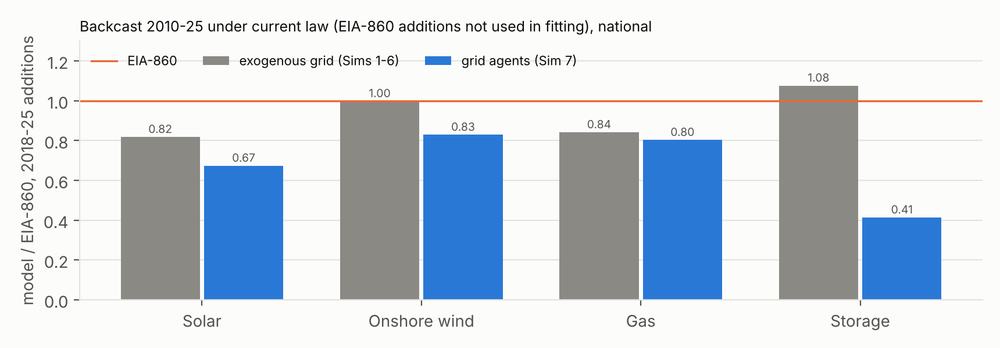

# What BAAJA would do to US electricity supply: a simulation of permitting, courts and the interconnection queue

*Methods and results brief, 25 November 2026. Model, data and code: this repository. Full model description:
[`docs/ODD.md`](ODD.md). Section map of the bill: [`docs/bill_question_map.md`](bill_question_map.md). Every model
number in this brief is generated from the results files by `baaja/brief_numbers.py` from the template
`docs/brief_src.md`.*

## Summary

The Bipartisan American Affordability and Jobs Act (BAAJA) was introduced as S.5653 on 30 September 2026 and adopted
with changes as S.Amdt. 6883 to H.R. 2347, which the Senate passed on 19 November 2026 by 62 to 33. The House has not
yet acted on it. The model assumes enactment in November 2026; later enactment moves every date below by the same
amount. I ask how much generating and storage capacity the Senate-passed text would bring online in the United States
by November 2041, in which regions, and what that does to regional reserve margins. Current law brings about
{{sim7:results/Current law/totals/GW_new/mean ; .0f}} GW of new capacity online by then.

Whether the bill adds capacity or removes it depends on how its interconnection reform is read, and the statute does
not settle that. Sec.2106 requires the study process of each regional transmission organization (RTO) to have "a single decision point" (new Federal Power Act
s.228(a)(3)(A)) without saying what that point replaces. Under current law RTOs re-study a cluster after its first
results, and in SPP's posted studies the upgrade costs of most requests that stayed fell at the re-study. I model three
readings, each with every RTO changing its process:

- If a request decides once, on its first-result cost, the bill brings
  {{sim7:results/BAAJA, Sec.2106 adopted by every RTO/diff_vs_baseline/GW_new/mean ; abs.1f}} GW less online than
  current law with SPP's re-study round of 17 months, and
  {{dec:B months=8 (Order No. 2023 pro forma)|full Sec.2106/diff_GW_new/mean ; abs.1f}} GW less with an 8-month round.
  Requests that the re-study would have kept leave at the first result.
- If only requests at the planned locations Sec.2106 publishes skip the re-study, the bill adds
  {{dec:A|only published locations skip the round/diff_GW_new/mean ; .1f}} GW.
- If requests still learn their re-studied cost but decide and sign at the first result, the bill adds
  {{dec:A|re-study cost change kept/diff_GW_new/mean ; .1f}} GW.

If no RTO changes its process, which the Federal Energy Regulatory Commission (FERC) may allow under s.228(d), the bill adds
{{sim7:results/BAAJA without Sec.2106/diff_vs_baseline/GW_new/mean ; .1f}} GW
[{{sim7:results/BAAJA without Sec.2106/diff_vs_baseline/GW_new/p5 ; .1f}},
{{sim7:results/BAAJA without Sec.2106/diff_vs_baseline/GW_new/p95 ; .1f}}] (5th-95th percentile across 100 paired
runs) from the permitting, court and permit-certainty provisions and from advanced transmission technologies
(Sec.2109). With each RTO changing its process with probability one half, on the first-result reading, the result is
{{sim7:results/BAAJA/diff_vs_baseline/GW_new/mean ; +.1f}} GW
[{{sim7:results/BAAJA/diff_vs_baseline/GW_new/p5 ; +.1f}}, {{sim7:results/BAAJA/diff_vs_baseline/GW_new/p95 ; +.1f}}].
The probability of one half is a convention, and I do not treat that number as a forecast.

The precedent on adoption cuts against reading s.228(d) as an easy way out. Under Order No. 2023, FERC required each
of the five RTOs whose compliance orders I could read (CAISO, ISO-NE, NYISO, PJM and SPP) to file further changes, and
accepted none of the five filings as filed; ISO-NE moved from serial to cluster studies and NYISO ended its Class Year
process. What FERC will count as a single decision point is not known, and one rule sets the standard for every RTO,
so outcomes are likely to move together.

Little changes before 2033. The bill gives FERC 18 months for the rule and RTOs two years from enactment to file; at
Order No. 2023's pace a first compliance order would come 35 to 38 months after enactment, and the model starts
reformed studies at three years (range two to four). On the first-result reading the bill first brings capacity
sooner, because requests that stay sign without waiting for the re-study, and then less: with every RTO changing its
process the gain peaks at
{{sim7:timing/BAAJA, Sec.2106 adopted by every RTO/7/mean ; .1f}} GW in 2034 and turns negative by 2037. The loss also
keeps growing after 2041. Of the new requests in RTO regions,
{{dec:A|+ relative screen (central)/diff_new_rto_online ; abs.1f}} GW fewer are online by November 2041, but
{{dec:A|+ relative screen (central)/diff_new_rto_ever ; abs.1f}} GW fewer ever complete.

PJM loses most on the first-result reading
({{dec:A|+ relative screen (central)/diff_region/PJM ; abs.1f}} GW less with every RTO changing), and MISO is close to
zero ({{dec:A|+ relative screen (central)/diff_region/MISO ; +.1f}} GW), because MISO's study capacity falls well short
of the requests arriving and a single decision shortens its queue. On the reading that keeps the re-studied cost,
MISO gains {{dec:A|re-study cost change kept/diff_region/MISO ; .1f}} of the
{{dec:A|re-study cost change kept/diff_GW_new/mean ; .1f}} GW.

Under current law the national shortfall below NERC's Reference Margin Levels reaches about
{{sim7:adequacy_current_law/grid agents (this simulation)/national/2035/mean ; .0f}} GW in 2035, most of it in PJM
({{sim7:adequacy_current_law/grid agents (this simulation)/region_2035/PJM ; .0f}} GW). Because the bill brings some
capacity sooner, it reduces the 2035 shortfall by
{{sim7:supply/BAAJA/shortfall_2035/mean ; abs.1f}} GW with each RTO changing with probability one half and
{{sim7:supply/BAAJA, Sec.2106 adopted by every RTO/shortfall_2035/mean ; abs.1f}} GW with every RTO changing; on the
first-result reading it raises the 2041 shortfall. In no case does it close the gap.

The published estimates (Resources for the Future, about 60 GW more clean capacity in 2028; Rhodium Group, 17 to 249
GW through 2040) come from capacity-expansion models that set the extent of interconnection relief by assumption and
add transmission under the bill. I find the bill's interconnection effect small by 2028 under any reading, and its
sign by 2041 set by a design choice the statute leaves to FERC.

Two features of the evidence make the negative numbers likely to be too negative. SPP's re-study changes are measured
on the requests still in a cluster at its later postings, which leans the sample toward cost falls; with the measured
changes halved, the central case becomes {{sim7:sensitivity/restudy_scale/diff_low ; +.1f}} GW (20 paired runs). And in
the 2010-25 backcast the model's completion falls more steeply with upgrade cost than in LBNL's data (section 6),
which raises the cost of deciding on a higher first-result cost.

My previous draft gave 36.5 GW in the central case and 65.0 GW with every RTO changing its process. A third review
found three bugs, and a design choice that favored the bill: in the model, the re-study could only push requests
out, because a request whose cost fell at the re-study could not return. With SPP's measured cost changes and that
return allowed, the current-law round keeps requests that a single decision on the first-result cost loses. If the
re-study left costs unchanged, every RTO changing its process would add
{{dec:B costs unchanged by re-study|full Sec.2106/diff_GW_new/mean ; .1f}} GW.



## 1. The bill and the question

BAAJA is a permitting and transmission bill. The provisions that bear on generating capacity fall into four groups
(full map, with each section's status, in `docs/bill_question_map.md`):

| group | main sections modeled | what changes in the model |
|---|---|---|
| Permitting | 1105 and 1108 (level of review), 1106 (enforcement of the existing one-year EA and two-year EIS deadlines, new deadlines for decisions after the review), 1202 (tighter rules on the existing one-year Clean Water Act s.401 clock), 1302 (ESA consultation timeline), 2213 (clocks for renewable and storage rights-of-way on federal land), 2229 | months to a federal permit |
| Courts | 1110 (150-day limit, comment exhaustion and remand without vacatur for NEPA claims) and 2201 (150-day limit and expedited review for energy authorizations); 1134 sets a 150-day limit for FAST-41 claims (1205 and 1305, for s.404 approvals and ESA opinions, are listed but not modeled separately) | how many suits are filed and how many halt a project |
| Permit certainty | 1401 | whether a permit can be revoked or suspended after issue |
| Grid access | 2106 (interconnection reform in RTOs/ISOs), 2110 (study automation), 2109 (advanced transmission technologies), 2101, 2102(a) and 2214 (transmission permitting) | who enters the interconnection queue, who leaves it, how long studies take, how much hosting room the grid has |

An RTO or ISO (regional transmission organization, independent system operator) runs the grid and the wholesale
market in its region under the Federal Energy Regulatory Commission (FERC). Six of them are FERC-jurisdictional:
CAISO, ISO-NE, MISO, NYISO, PJM and SPP. A generator that wants to connect files an interconnection request; the RTO
studies requests together in a cluster and assigns each one the cost of the network upgrades its connection needs.
Hosting room is the capacity the existing grid can take without such upgrades. The new s.228 applies to each
"Transmission Organization", an existing Federal Power Act term, and has no ERCOT clause, unlike ss.216 and 225(b)(1).
I infer that it does not reach ERCOT, which is outside FERC's rate and interconnection jurisdiction, or the Southeast
and most of the non-ISO West, which have no RTO.

Sections 1203 and 1204 (NPDES permit term and Clean Water Act s.404) are listed but not modeled, because they act
on existing plants and on wetlands permits the model cannot attach to generation projects.

The model asks how much capacity comes online by region and year with and without the bill, and what that does to
each region's reserve margin. It does not estimate prices, emissions or customer bills.

Several provisions that bear on supply are outside the model. Sec.2107 lets a state condition retail service to a
data center on the data center's procuring new generation sufficient to serve its demand (new FPA s.229(c)(1)(D)),
which acts on the demand behind the adequacy gap. Sec.2108 bars RTOs from blocking aggregations of behind-the-meter
storage, fuel cells and generators of 5 kW to 5 MW each from wholesale markets, which is capacity outside the
interconnection queue. Sec.2102(b) exempts interstate gas pipeline looping and compression in existing corridors from
NEPA review. Sec.2109 (new FPA s.232) requires public utilities to evaluate advanced transmission technologies on
their systems (s.232(b)(1)) and to use them on new and upgraded lines where benefits exceed costs (s.232(b)(2)); the
model credits only the second, as extra hosting room on every line that reaches operation from the rule month on,
model lines and MISO's approved Long Range Transmission Plan lines alike, and only for the public-utility share of
each region (s.232(d) applies "only to public utilities"). Sec.2103 adds interregional
planning with cost allocation; its new FPA s.225(h) deems FERC's orders published in the Federal Register on 11 June
2024, 6 December 2024 and 28 April 2025 (by their dates, Order No. 1920 and its two orders on rehearing) to satisfy
the regional planning requirements. In my reading Sec.2103 is the bill's main route to new transmission, and the model
plans no new lines in response to the bill. Sec.1501-1504 (nuclear licensing) are listed but not modeled, because
no new reactor reaches operation through the queue data by 2041.

## 2. The model

The full description, in the ODD form of Grimm et al. (2020), is in `docs/ODD.md`. In short, it is a model of the
interconnection queue with decision rules for grid operators and developers, coupled to a permitting and litigation
pipeline and to a supply-and-adequacy account.

Projects. Every generation, storage and transmission request from 2026 to 2041, plus the queue standing at the end
of 2025, is drawn from LBNL interconnection-queue data by technology and region (Rand et al. 2026). Each goes through
federal permitting if it has a federal hook, possible litigation, possible federal halt, interconnection and
construction. Permitting and litigation are sized from CEQ, BLM, Army Corps and NEPA-litigation data.

Grid operators, one per region, study requests in clusters (ERCOT one at a time) with a throughput fitted to LBNL
request-to-agreement times. They allocate network-upgrade costs drawn from LBNL's regional cost studies (LBNL
2021-24); costs rise with the capacity signed in a region and fall as transmission is finished. The rate of rise is my
fit to LBNL's cost data: the cost of requests made since 2018 against those of 2010-17, per GW reaching operation in
2014-21. It is zero in ERCOT, which did not allocate network upgrades to generators through 2025. Because that rate is
net of the transmission built over the same years, the central case adds as current-law hosting room only the
transmission that is a step above a region's historical pace: MISO's Long Range Transmission Plan Tranches 1 and 2.1
($10.3 billion, in service 2028-30, spread evenly over those years by my assumption; and $21.9 billion summed over
the 24 Tranche 2.1 projects in MTEP25's table, in service 2032-34, which MISO's text gives as $21.8 billion), from July
of each in-service year, in project-equivalents at the cost of an
average Tranche 1 project ($0.57 billion). SPP's 2025 Integrated Transmission Plan ($8.6 billion) and PJM's 2025
Regional Transmission Expansion Plan lines of 500 kV and above ($9.8 billion) are a sensitivity (section 5).

Under current law in cluster regions, the operator runs one re-study round between the first complete study result
and the agreement. The first result comes no sooner than five months (150 days) after the cluster study starts. Each
request's upgrade cost then changes by a factor drawn from the 325 request-level changes in SPP's posted results
between Phase 2 and the latest posting, for its eight clusters from 2017-1 to 2023-1 (median -15%, with more falls than rises; SPP
2020-26, `data/spp_restudy.json`), and by 0.1 times the amount by which the share of capacity that withdrew exceeds
SPP's median of 0.45 (standard error about 0.8, so not distinguishable from zero). A request whose first result
made it unprofitable, and which is still holding its position when the re-study comes, stays if the new cost is
within its value; a request whose cost rises above its value at re-study leaves at the agreement stage. The agreement
comes 17 months after the first result. That figure is the median time in SPP from the Phase 2 posting to the latest
restudy posting, a censored measure, since SPP's queue file gives no agreement dates; the range is 8 months (the pro
forma on-time path of Order No. 2023, a 150-day restudy plus a 90-day facilities study) to 29. SPP is the one RTO
whose successive cluster postings I could obtain, and its clusters predate Order No. 2023.

Developers enter on the published wait and on their region's projected capacity shortfall. At each study result they
compare the allocated upgrade cost with the project's value and stay or leave. The shape of the value distribution
comes from my fit of completion on upgrade cost to LBNL's cost data, which also says that a share of requests do not
complete at any cost: 23% in RTO regions and 51% elsewhere. In the model those requests leave whatever their cost. The
share is refitted so that, in the 2010-25 backcast, requests with no upgrade cost complete at the fitted rate (77% and
49%), since background withdrawal also acts on them; the refitted share that can complete is
{{cal:calibration/grid_cal/value_a/ISO ; .0%}} in RTO regions and {{cal:calibration/grid_cal/value_a/non-ISO ; .0%}} elsewhere. The level of value is one scale per technology and region,
fitted so that completion matches LBNL's rates. Value here stands for every reason a project completes or not that the
model does not otherwise represent; it is not revenue, and the model has no prices. Developers also withdraw over time
at background rates fitted by region, including while they wait for the re-study. A developer whose result is adverse
holds its position for a fitted time before leaving; the hold sets when its withdrawal is recorded and whether it is
still in the queue when the re-study comes.

Supply. What comes online is added to the EIA-860 fleet, less announced and age-based retirements, and compared with
NERC's 2025 peak-demand forecast and reference margin levels (NERC 2026). Wind, solar and batteries count at on-peak
shares that start at NERC's national values and fall halfway to PJM's 2041/42 ELCC class ratings by 2041 (on-peak
accredited capacity below). PJM is the exception: its reference margin is an installed reserve margin that already
rises (18.6% to 35.1%, 2026-34) as its mix shifts to these resources, so its shares stay at their 2026 values and the
decline is not counted twice.

The bill enters as mechanisms. Under Sec.2106 a reformed RTO publishes planned interconnection locations with "an
upfront, fixed, subregional, per-megawatt fee" (new FPA s.228(a)(2)(B)) and establishes a study process with "(A) a
single decision point; (B) meaningful and nonrefundable financial security; and (C) withdrawal penalties after the
determination of total costs of interconnection and any limitations from contingencies are provided to the customer
that are sufficient to deter speculative projects" (s.228(a)(3)). The statute does not say what the single decision
point removes, and the result turns on it. I model three readings. In the central one, the single decision point
removes the re-study round for every request made after the rule in an RTO whose process changes: requests decide
once, at their first result and its cost, and those that stay sign then. In the second, only requests at published
locations, whose cost is fixed, skip the round, and the rest keep it, since "any limitations from contingencies" may
still have to be studied. In the third, the round's cost changes still happen but are known at the single decision.
The cost that other requests' withdrawals would have shifted onto those who stay is assumed to be covered by forfeited
security and penalties, which the model does not check.

The remaining choices are also mine. The fee is set at the region's expected upgrade cost, and requests at a
published location are exempt from the screen. The security in (B) is represented as an entry screen, applied before
costs are known: within each technology and region, the quarter of new requests least likely to complete (range a
tenth to a half) do not enter, with the requests that fail at any cost at the bottom of that ranking. The penalty in
(C) shortens how long a developer holds its position after an adverse result. A quarter is close to the median share
of 2015-19 requests that RTOs saw withdrawn within a year (about 0.3 across the six RTOs in LBNL's data, from 0.14 in
SPP to 0.58 in CAISO), the requests that Johnston, Liu and Yang (2023, revised 2026) find higher entry costs deter.
For PJM they find that higher queue-entry costs have little effect on completed capacity (-1.2% to +0.8%), because
they mainly deter requests that would have left quickly. Each RTO's process changes with probability 0.5 in the
central case, drawn independently for each RTO.

The screen was first specified as an absolute threshold on the modeled chance of completing. That depends on the
fitted value scales, and after an earlier refit it kept out nearly all new storage requests in PJM. I changed to a
relative screen, a share kept out, after seeing results; I should have specified it that way before running. The
relative screen is a quota: it fixes the share kept out instead of deriving it from the size of the deposit. Both
versions, and no screen, are in section 4.4. Sec.2110 is a study-throughput gain, zero in the central case because the
bill sets no target.

Each bill scenario is run against current law with the same random numbers, so differences come from the bill
instead of sampling noise. There are 100 paired runs per scenario and 400 joint Latin-hypercube samples of every
assumption range for the uncertainty analysis (Saltelli et al. 2008).

A simpler version of the model (Sims 1-6) draws interconnection time from the historical distribution instead of
from the queue. Its results appear alongside as a check and are labeled as such.

## 3. Data

All inputs are public. Sources, retrieval dates and file hashes are in `data/SOURCES.md`.

- Interconnection: LBNL *Queued Up* workbook (requests through 2025) and LBNL interconnection-cost studies for MISO,
  PJM, SPP, NYISO, ISO-NE and non-ISO balancing areas (used for the Southeast and West). SPP's DISIS results
  workbooks for clusters 2016-2 to 2023-1, every posting (the re-study round). PJM's planning-queue export and ERCOT's
  monthly Generator Interconnection Status reports (December 2018-2025 and October 2026), used as checks. The CAISO,
  MISO and NYISO queue files were downloaded for cross-checks but are not used.
- Transmission plans: MISO MTEP25 Chapter 2 (Regional/Long Range Transmission Planning), SPP's 2025 Integrated
  Transmission Plan and PJM's 2025 Regional Transmission Expansion Plan.
- FERC: the orders on Order No. 2023 compliance for CAISO, ISO-NE, NYISO, PJM and SPP (2025-26), used for the timing
  and adoption assumptions. MISO's order could not be retrieved (the site refused automated requests).
- Utilities: EIA-861 (2025) retail sales by ownership, for the public-utility share that Sec.2109 reaches.
- Permitting: CEQ EIS timelines, BLM MLRS rights-of-way cases, Army Corps permit data.
- Courts: a case-level export of 1,821 NEPA cases filed 2001-22 (supplied; publisher to be recorded in
  `data/SOURCES.md`); Sabin Center renewable-opposition database.
- Fleet, retirements and generation: EIA-860 (2015-2025), EIA-860M, EIA-923.
- Demand and adequacy: NERC 2025 Long-Term Reliability Assessment; PJM ELCC class ratings.
- Bill text: the Senate floor copy of S.Amdt. 6883 (KAT26804 V62), checked against the engrossed Senate amendment to
  H.R. 2347 (GovInfo, BILLS-119hr2347eas). All 83 sections are identical in letters and digits, apart from two section
  labels in Sec.2301-2302 and the attestation at the end.

## 4. Results

All numbers in this section are from the grid-agent model (Sim 7, `results/sim7_grid_agents.json`, and the
decomposition runs, `results/sec2106_decomposition.json`): means across 100 paired runs, with the 5th and 95th
percentiles in brackets, for capacity online by November 2041. New capacity excludes relicensed hydro, which is
reported separately. "Sec.2106 is worth" a number means the bill with Sec.2106 minus the bill without it.

### 4.1 How much, by reading of the single decision point

| scenario (first-result reading unless stated) | new capacity GW | renewables GW | gas GW | storage GW |
|---|---|---|---|---|
| BAAJA, no RTO changes its process (Sec.2106 off) | {{sim7:results/BAAJA without Sec.2106/diff_vs_baseline/GW_new/mean ; +.1f}} [{{sim7:results/BAAJA without Sec.2106/diff_vs_baseline/GW_new/p5 ; +.1f}}, {{sim7:results/BAAJA without Sec.2106/diff_vs_baseline/GW_new/p95 ; +.1f}}] | {{sim7:results/BAAJA without Sec.2106/diff_vs_baseline/GW Renewable (new)/mean ; +.1f}} | {{sim7:results/BAAJA without Sec.2106/diff_vs_baseline/GW Fossil (gas)/mean ; +.1f}} | {{sim7:results/BAAJA without Sec.2106/diff_vs_baseline/GW Storage/mean ; +.1f}} |
| BAAJA, each RTO changes its process with probability 0.5 (convention) | {{sim7:results/BAAJA/diff_vs_baseline/GW_new/mean ; +.1f}} [{{sim7:results/BAAJA/diff_vs_baseline/GW_new/p5 ; +.1f}}, {{sim7:results/BAAJA/diff_vs_baseline/GW_new/p95 ; +.1f}}] | {{sim7:results/BAAJA/diff_vs_baseline/GW Renewable (new)/mean ; +.1f}} | {{sim7:results/BAAJA/diff_vs_baseline/GW Fossil (gas)/mean ; +.1f}} | {{sim7:results/BAAJA/diff_vs_baseline/GW Storage/mean ; +.1f}} |
| BAAJA, every RTO changes its process | {{sim7:results/BAAJA, Sec.2106 adopted by every RTO/diff_vs_baseline/GW_new/mean ; +.1f}} [{{sim7:results/BAAJA, Sec.2106 adopted by every RTO/diff_vs_baseline/GW_new/p5 ; +.1f}}, {{sim7:results/BAAJA, Sec.2106 adopted by every RTO/diff_vs_baseline/GW_new/p95 ; +.1f}}] | {{sim7:results/BAAJA, Sec.2106 adopted by every RTO/diff_vs_baseline/GW Renewable (new)/mean ; +.1f}} | {{sim7:results/BAAJA, Sec.2106 adopted by every RTO/diff_vs_baseline/GW Fossil (gas)/mean ; +.1f}} | {{sim7:results/BAAJA, Sec.2106 adopted by every RTO/diff_vs_baseline/GW Storage/mean ; +.1f}} |
| BAAJA, probability 0.5, plus a 25% study-throughput gain under Sec.2110 | {{sim7:results/BAAJA + Sec.2110 throughput +25%/diff_vs_baseline/GW_new/mean ; +.1f}} [{{sim7:results/BAAJA + Sec.2110 throughput +25%/diff_vs_baseline/GW_new/p5 ; +.1f}}, {{sim7:results/BAAJA + Sec.2110 throughput +25%/diff_vs_baseline/GW_new/p95 ; +.1f}}] | {{sim7:results/BAAJA + Sec.2110 throughput +25%/diff_vs_baseline/GW Renewable (new)/mean ; +.1f}} | {{sim7:results/BAAJA + Sec.2110 throughput +25%/diff_vs_baseline/GW Fossil (gas)/mean ; +.1f}} | {{sim7:results/BAAJA + Sec.2110 throughput +25%/diff_vs_baseline/GW Storage/mean ; +.1f}} |

Current law brings {{sim7:results/Current law/totals/GW_new/mean ; .0f}} GW of new capacity online by November 2041
[{{sim7:results/Current law/totals/GW_new/p5 ; .0f}}, {{sim7:results/Current law/totals/GW_new/p95 ; .0f}}]. The first
row keeps every provision except Sec.2106: the permitting, court and permit-certainty provisions (Division A, Titles
I-IV; Division B, Titles I and II, apart from Sec.2106, 2109 and 2110), Sec.2109, and Sec.2110 at zero. On their own, with Sec.2109 also off, the permitting,
court and certainty provisions add {{dec:A|Titles I-II only (no Sec.2106, no Sec.2109)/diff_GW_new/mean ; .1f}} GW
[{{dec:A|Titles I-II only (no Sec.2106, no Sec.2109)/diff_GW_new/p5 ; .1f}},
{{dec:A|Titles I-II only (no Sec.2106, no Sec.2109)/diff_GW_new/p95 ; .1f}}]. Sec.2109's extra hosting room is worth
{{sim7:results/BAAJA/diff_vs_baseline/GW_new/mean - sim7:results/BAAJA without Sec.2109 hosting/diff_vs_baseline/GW_new/mean ; .1f}}
GW in the central case. Existing hydro whose new license comes sooner accounts for a further
{{sim7:results/BAAJA/diff_vs_baseline/GW Renewable (retained hydro)/mean ; .1f}} GW in every bill scenario; it is
existing capacity kept in service, and I do not count it as new. On the first-result reading gas rises while
renewables and storage fall.

The readings of Sec.2106 change the result more than anything else:

| reading of Sec.2106 | every RTO changes | each RTO with probability 0.5 |
|---|---|---|
| decision on the first-result cost, 17-month current-law round (central reading) | {{dec:A|+ relative screen (central)/diff_GW_new/mean ; +.1f}} [{{dec:A|+ relative screen (central)/diff_GW_new/p5 ; +.1f}}, {{dec:A|+ relative screen (central)/diff_GW_new/p95 ; +.1f}}] | {{dec:A|p=0.5: relative screen (central)/diff_GW_new/mean ; +.1f}} |
| decision on the first-result cost, 8-month current-law round | {{dec:B months=8 (Order No. 2023 pro forma)|full Sec.2106/diff_GW_new/mean ; +.1f}} [{{dec:B months=8 (Order No. 2023 pro forma)|full Sec.2106/diff_GW_new/p5 ; +.1f}}, {{dec:B months=8 (Order No. 2023 pro forma)|full Sec.2106/diff_GW_new/p95 ; +.1f}}] | {{dec:B months=8 (Order No. 2023 pro forma)|p=0.5/diff_GW_new/mean ; +.1f}} |
| only requests at published locations skip the round | {{dec:A|only published locations skip the round/diff_GW_new/mean ; +.1f}} [{{dec:A|only published locations skip the round/diff_GW_new/p5 ; +.1f}}, {{dec:A|only published locations skip the round/diff_GW_new/p95 ; +.1f}}] | {{dec:A|p=0.5: only published locations skip the round/diff_GW_new/mean ; +.1f}} |
| re-studied cost known at the single decision | {{dec:A|re-study cost change kept/diff_GW_new/mean ; +.1f}} [{{dec:A|re-study cost change kept/diff_GW_new/p5 ; +.1f}}, {{dec:A|re-study cost change kept/diff_GW_new/p95 ; +.1f}}] | {{dec:A|p=0.5: re-study cost change kept/diff_GW_new/mean ; +.1f}} |

The interval on the probability-0.5 row of the first table is wide because it mostly records which RTOs happen to
change their process in each run. The probability of one half is an assumption. The closest precedent is Order No.
2023: FERC required further filings from each of the five RTOs whose orders I read and found none compliant as filed;
under it ISO-NE moved from serial to cluster studies and NYISO replaced its Class Year with a cluster process (FERC
2025a-f; 2026a-b). FERC has therefore made RTOs change their processes, but under a rule that set specific requirements;
s.228(d) lets FERC find an existing process compliant, or a comparable one sufficient. Adoption is drawn independently
for each RTO here, although one rule sets the standard for all six, so the spread on that row understates the chance
of all-or-nothing outcomes.

The simpler model, with study times drawn from history and Sec.2106 and Sec.2110 set to zero, gives
{{sim7:exogenous/BAAJA (exogenous grid)/diff_vs_baseline/GW_new/mean ; +.1f}} GW
[{{sim7:exogenous/BAAJA (exogenous grid)/diff_vs_baseline/GW_new/p5 ; +.1f}},
{{sim7:exogenous/BAAJA (exogenous grid)/diff_vs_baseline/GW_new/p95 ; +.1f}}] for the permitting, court and certainty
provisions, and has no Sec.2109. With the grid agents the same provisions give
{{dec:A|Titles I-II only (no Sec.2106, no Sec.2109)/diff_GW_new/mean ; .1f}} GW. The simpler model validates better on these provisions
(section 6), and I take its figure as the better estimate for them.

### 4.2 When

| year (to November) | current law: new GW that year | BAAJA, probability 0.5: cumulative GW vs current law | no RTO changes | every RTO changes |
|---|---|---|---|---|
| 2028 | {{sim7:timing/current_law_additions/1 ; .0f}} | {{sim7:timing/BAAJA/1/mean ; +.1f}} | {{sim7:timing/BAAJA without Sec.2106/1/mean ; +.1f}} | {{sim7:timing/BAAJA, Sec.2106 adopted by every RTO/1/mean ; +.1f}} |
| 2030 | {{sim7:timing/current_law_additions/3 ; .0f}} | {{sim7:timing/BAAJA/3/mean ; +.1f}} | {{sim7:timing/BAAJA without Sec.2106/3/mean ; +.1f}} | {{sim7:timing/BAAJA, Sec.2106 adopted by every RTO/3/mean ; +.1f}} |
| 2032 | {{sim7:timing/current_law_additions/5 ; .0f}} | {{sim7:timing/BAAJA/5/mean ; +.1f}} | {{sim7:timing/BAAJA without Sec.2106/5/mean ; +.1f}} | {{sim7:timing/BAAJA, Sec.2106 adopted by every RTO/5/mean ; +.1f}} |
| 2034 | {{sim7:timing/current_law_additions/7 ; .0f}} | {{sim7:timing/BAAJA/7/mean ; +.1f}} | {{sim7:timing/BAAJA without Sec.2106/7/mean ; +.1f}} | {{sim7:timing/BAAJA, Sec.2106 adopted by every RTO/7/mean ; +.1f}} |
| 2035 | {{sim7:timing/current_law_additions/8 ; .0f}} | {{sim7:timing/BAAJA/8/mean ; +.1f}} [{{sim7:timing/BAAJA/8/p5 ; +.1f}}, {{sim7:timing/BAAJA/8/p95 ; +.1f}}] | {{sim7:timing/BAAJA without Sec.2106/8/mean ; +.1f}} | {{sim7:timing/BAAJA, Sec.2106 adopted by every RTO/8/mean ; +.1f}} |
| 2038 | {{sim7:timing/current_law_additions/11 ; .0f}} | {{sim7:timing/BAAJA/11/mean ; +.1f}} | {{sim7:timing/BAAJA without Sec.2106/11/mean ; +.1f}} | {{sim7:timing/BAAJA, Sec.2106 adopted by every RTO/11/mean ; +.1f}} |
| 2041 | {{sim7:timing/current_law_additions/14 ; .0f}} | {{sim7:timing/BAAJA/14/mean ; +.1f}} | {{sim7:timing/BAAJA without Sec.2106/14/mean ; +.1f}} | {{sim7:timing/BAAJA, Sec.2106 adopted by every RTO/14/mean ; +.1f}} |

The bill adds under 1 GW before 2033. The permitting and court provisions add a little each year from the start. The
model applies Sec.2106 only to requests made after reformed studies start (late 2029 in the central case, an
assumption; the new s.228 has no transition clause for requests already queued), and the first of those come online
around 2033. On the first-result reading the requests that stay at the single decision point sign without waiting
for the re-study, so the bill first brings capacity sooner. The requests that the re-study would have kept are gone,
so the gain turns into a loss in the late 2030s, and the loss is still growing in 2041: with every RTO changing its
process, {{dec:A|+ relative screen (central)/diff_new_rto_online ; abs.1f}} GW fewer new requests in RTO regions are
online by November 2041, and {{dec:A|+ relative screen (central)/diff_new_rto_ever ; abs.1f}} GW fewer ever complete.

Current-law additions peak at {{sim7:timing/current_law_additions/2 ; .0f}} GW in 2029, while the queue standing at
the end of 2025 is being built, then settle at 50 to 65 GW a year. The peak is about twice the largest year in EIA-860
for these technologies (57.6 GW in 2025); the model puts no supply-chain or labor limit on construction.

### 4.3 Where



| region | current law GW online by 2041 | probability 0.5, first-result reading | every RTO: first-result reading | every RTO: only published locations skip | every RTO: re-studied cost known |
|---|---|---|---|---|---|
| CAISO | {{sim7:regions/Current law/CAISO/GW_online ; .0f}} | {{sim7:regions/BAAJA/CAISO/GW_online - sim7:regions/Current law/CAISO/GW_online ; +.1f}} | {{dec:A|+ relative screen (central)/diff_region/CAISO ; +.1f}} | {{dec:A|only published locations skip the round/diff_region/CAISO ; +.1f}} | {{dec:A|re-study cost change kept/diff_region/CAISO ; +.1f}} |
| ISO-NE | {{sim7:regions/Current law/ISO-NE/GW_online ; .0f}} | {{sim7:regions/BAAJA/ISO-NE/GW_online - sim7:regions/Current law/ISO-NE/GW_online ; +.1f}} | {{dec:A|+ relative screen (central)/diff_region/ISO-NE ; +.1f}} | {{dec:A|only published locations skip the round/diff_region/ISO-NE ; +.1f}} | {{dec:A|re-study cost change kept/diff_region/ISO-NE ; +.1f}} |
| MISO | {{sim7:regions/Current law/MISO/GW_online ; .0f}} | {{sim7:regions/BAAJA/MISO/GW_online - sim7:regions/Current law/MISO/GW_online ; +.1f}} | {{dec:A|+ relative screen (central)/diff_region/MISO ; +.1f}} | {{dec:A|only published locations skip the round/diff_region/MISO ; +.1f}} | {{dec:A|re-study cost change kept/diff_region/MISO ; +.1f}} |
| NYISO | {{sim7:regions/Current law/NYISO/GW_online ; .0f}} | {{sim7:regions/BAAJA/NYISO/GW_online - sim7:regions/Current law/NYISO/GW_online ; +.1f}} | {{dec:A|+ relative screen (central)/diff_region/NYISO ; +.1f}} | {{dec:A|only published locations skip the round/diff_region/NYISO ; +.1f}} | {{dec:A|re-study cost change kept/diff_region/NYISO ; +.1f}} |
| PJM | {{sim7:regions/Current law/PJM/GW_online ; .0f}} | {{sim7:regions/BAAJA/PJM/GW_online - sim7:regions/Current law/PJM/GW_online ; +.1f}} | {{dec:A|+ relative screen (central)/diff_region/PJM ; +.1f}} | {{dec:A|only published locations skip the round/diff_region/PJM ; +.1f}} | {{dec:A|re-study cost change kept/diff_region/PJM ; +.1f}} |
| SPP | {{sim7:regions/Current law/SPP/GW_online ; .0f}} | {{sim7:regions/BAAJA/SPP/GW_online - sim7:regions/Current law/SPP/GW_online ; +.1f}} | {{dec:A|+ relative screen (central)/diff_region/SPP ; +.1f}} | {{dec:A|only published locations skip the round/diff_region/SPP ; +.1f}} | {{dec:A|re-study cost change kept/diff_region/SPP ; +.1f}} |
| ERCOT | {{sim7:regions/Current law/ERCOT/GW_online ; .0f}} | {{sim7:regions/BAAJA/ERCOT/GW_online - sim7:regions/Current law/ERCOT/GW_online ; +.1f}} | {{dec:A|+ relative screen (central)/diff_region/ERCOT ; +.1f}} | {{dec:A|only published locations skip the round/diff_region/ERCOT ; +.1f}} | {{dec:A|re-study cost change kept/diff_region/ERCOT ; +.1f}} |
| Southeast | {{sim7:regions/Current law/Southeast/GW_online ; .0f}} | {{sim7:regions/BAAJA/Southeast/GW_online - sim7:regions/Current law/Southeast/GW_online ; +.1f}} | {{dec:A|+ relative screen (central)/diff_region/Southeast ; +.1f}} | {{dec:A|only published locations skip the round/diff_region/Southeast ; +.1f}} | {{dec:A|re-study cost change kept/diff_region/Southeast ; +.1f}} |
| West | {{sim7:regions/Current law/West/GW_online ; .0f}} | {{sim7:regions/BAAJA/West/GW_online - sim7:regions/Current law/West/GW_online ; +.1f}} | {{dec:A|+ relative screen (central)/diff_region/West ; +.1f}} | {{dec:A|only published locations skip the round/diff_region/West ; +.1f}} | {{dec:A|re-study cost change kept/diff_region/West ; +.1f}} |

ERCOT, the Southeast and the non-ISO West gain only from the provisions that apply everywhere; the Southeast and the
West also gain from Sec.2109, which reaches the public-utility share of each region (s.232(d)).

MISO stands apart on every reading. Its fitted study capacity at the end of 2025 is
{{dec:_meta/throughput_over_arrivals/MISO ; .2f}} of the requests arriving, against
{{dec:_meta/throughput_over_arrivals/PJM ; .2f}} in PJM, so in MISO fewer and faster decisions shorten the queue for
everyone, and that offsets the requests lost at the first result. With PJM's ratio, MISO's result with every RTO
changing on the first-result reading falls to {{dec:C MISO throughput = PJM's|full Sec.2106/diff_region/MISO ; +.1f}}
GW, and the national result to {{dec:C MISO throughput = PJM's|full Sec.2106/diff_GW_new/mean ; +.1f}} GW. On the
reading that keeps the re-studied cost, MISO carries
{{dec:A|re-study cost change kept/diff_region/MISO ; .1f}} of the
{{dec:A|re-study cost change kept/diff_GW_new/mean ; .1f}} GW.

PJM loses most on the first-result reading. In the model most PJM requests that sign after the rule pay no upgrade
cost: with every RTO changing its process, {{dec:A|+ relative screen (central)/zero_cost/PJM|Solar/1 ; .0f}} of the
{{dec:A|+ relative screen (central)/zero_cost/PJM|Solar/0 ; .0f}} solar signers and
{{dec:A|+ relative screen (central)/zero_cost/PJM|Storage/1 ; .0f}} of the
{{dec:A|+ relative screen (central)/zero_cost/PJM|Storage/0 ; .0f}} storage signers (averages across runs). In LBNL's
PJM cost study {{dec:_meta/cost/PJM/zero_share ; .1%}} of requests pay no upgrade cost, against
{{cal:grid_fit/completion/Solar|PJM/1 ; .1%}} of PJM solar requests and
{{cal:grid_fit/completion/Storage|PJM/1 ; .1%}} of storage requests that complete, so the calibration sets low values
for both, and the storage value scale sits at its lower bound (section 6). The data do not show that route to
completion: in LBNL's PJM cost data, 12% of completed solar projects queued since 2010 have no upgrade cost, against 14%
of withdrawn ones (latest study for each project; my tabulation). With MISO's zero-cost share of
{{dec:_meta/cost/MISO/zero_share ; .1%}}, PJM's result with every RTO changing is
{{dec:C PJM zero-cost share = MISO's|full Sec.2106/diff_region/PJM ; +.1f}} GW, so this corner does not explain PJM's
loss.

### 4.4 The entry screen

| entry screen (first-result reading) | every RTO changes | each RTO with probability 0.5 |
|---|---|---|
| no entry screen | {{dec:A|+ published locations (no screen)/diff_GW_new/mean ; +.1f}} | {{dec:A|p=0.5: no screen/diff_GW_new/mean ; +.1f}} |
| bottom quarter within technology and region by chance of completing (central) | {{dec:A|+ relative screen (central)/diff_GW_new/mean ; +.1f}} | {{dec:A|p=0.5: relative screen (central)/diff_GW_new/mean ; +.1f}} |
| bottom quarter ranked by value alone | {{dec:A|screen ranked by value/diff_GW_new/mean ; +.1f}} | {{dec:A|p=0.5: screen ranked by value/diff_GW_new/mean ; +.1f}} |
| requests whose chance of completing is below 0.25 (first specification) | {{dec:A|+ absolute screen instead/diff_GW_new/mean ; +.1f}} | {{dec:A|p=0.5: absolute screen/diff_GW_new/mean ; +.1f}} |

The central screen ranks requests by their modeled chance of completing, with the requests that fail at any cost at
the bottom, so it mostly removes requests that would have left anyway, which is what Johnston, Liu and Yang find for
PJM's higher entry costs. On that ranking the screen changes the result by
{{dec:A|+ relative screen (central)/diff_GW_new/mean - dec:A|+ published locations (no screen)/diff_GW_new/mean ; +.1f}}
GW with every RTO changing. Ranking on value alone removes more completers. The absolute threshold I first specified
removes most storage requests in the cells where the fitted value scale is at its lower bound, and gives the much
lower row; I changed to the relative screen after seeing results (section 2).

In 20 paired runs (central case {{sim7:screen_sensitivity/current law: none; Sec.2106: relative 0.25 (central)/baaja ; +.1f}}
GW with probability 0.5, {{sim7:screen_sensitivity/current law: none; Sec.2106: relative 0.25 (central)/every_rto ; +.1f}}
GW with every RTO), assuming current law already screens out a tenth of requests, as Order No. 2023's readiness
deposits may, gives {{sim7:screen_sensitivity/current law: 0.1 share screened (Order 2023 deposits)/baaja ; +.1f}} and
{{sim7:screen_sensitivity/current law: 0.1 share screened (Order 2023 deposits)/every_rto ; +.1f}} GW. Keeping out half
of new requests instead of a quarter gives {{sim7:sensitivity/screen_2106/diff_high ; +.1f}} GW with probability 0.5,
and keeping out a tenth gives {{sim7:sensitivity/screen_2106/diff_low ; +.1f}} GW.

### 4.5 What the single decision point does

Under current law in cluster regions the model has one re-study round fitted to SPP (section 2). Each request's cost
changes by a draw from SPP's measured changes, most of them falls, and the agreement comes 17 months after the first
result. A request whose first result made it unprofitable and which is still holding its position stays if its
re-studied cost is within its value. On the central reading the single decision point removes the round, so that
request leaves. The table changes the round in current law and in the bill alike, with every RTO changing its process.

| current-law re-study round (law and bill) | current law GW | no RTO changes | single decision point only | full Sec.2106 | probability 0.5 |
|---|---|---|---|---|---|
| fitted to SPP, 17 months (central) | {{dec:A|law/GW_new/mean ; .0f}} | {{dec:A|without Sec.2106/diff_GW_new/mean ; +.1f}} | {{dec:A|single decision point only/diff_GW_new/mean ; +.1f}} | {{dec:A|+ relative screen (central)/diff_GW_new/mean ; +.1f}} | {{dec:A|p=0.5: relative screen (central)/diff_GW_new/mean ; +.1f}} |
| 8 months (Order No. 2023 pro forma, on time) | {{dec:B months=8 (Order No. 2023 pro forma)|law/GW_new/mean ; .0f}} | {{dec:B months=8 (Order No. 2023 pro forma)|without Sec.2106/diff_GW_new/mean ; +.1f}} | {{dec:B months=8 (Order No. 2023 pro forma)|single decision point only/diff_GW_new/mean ; +.1f}} | {{dec:B months=8 (Order No. 2023 pro forma)|full Sec.2106/diff_GW_new/mean ; +.1f}} | {{dec:B months=8 (Order No. 2023 pro forma)|p=0.5/diff_GW_new/mean ; +.1f}} |
| no request-level cost change | {{dec:B no request-level cost change (scale 0)|law/GW_new/mean ; .0f}} | {{dec:B no request-level cost change (scale 0)|without Sec.2106/diff_GW_new/mean ; +.1f}} | {{dec:B no request-level cost change (scale 0)|single decision point only/diff_GW_new/mean ; +.1f}} | {{dec:B no request-level cost change (scale 0)|full Sec.2106/diff_GW_new/mean ; +.1f}} | {{dec:B no request-level cost change (scale 0)|p=0.5/diff_GW_new/mean ; +.1f}} |
| costs unchanged by re-study | {{dec:B costs unchanged by re-study|law/GW_new/mean ; .0f}} | {{dec:B costs unchanged by re-study|without Sec.2106/diff_GW_new/mean ; +.1f}} | {{dec:B costs unchanged by re-study|single decision point only/diff_GW_new/mean ; +.1f}} | {{dec:B costs unchanged by re-study|full Sec.2106/diff_GW_new/mean ; +.1f}} | {{dec:B costs unchanged by re-study|p=0.5/diff_GW_new/mean ; +.1f}} |
| no re-study round | {{dec:B no re-study round|law/GW_new/mean ; .0f}} | {{dec:B no re-study round|without Sec.2106/diff_GW_new/mean ; +.1f}} | {{dec:B no re-study round|single decision point only/diff_GW_new/mean ; +.1f}} | {{dec:B no re-study round|full Sec.2106/diff_GW_new/mean ; +.1f}} | {{dec:B no re-study round|p=0.5/diff_GW_new/mean ; +.1f}} |
| SPP round, no background withdrawal during it | {{dec:H no background withdrawal during the round|law/GW_new/mean ; .0f}} | {{dec:H no background withdrawal during the round|without Sec.2106/diff_GW_new/mean ; +.1f}} | {{dec:H no background withdrawal during the round|single decision point only/diff_GW_new/mean ; +.1f}} | {{dec:H no background withdrawal during the round|full Sec.2106/diff_GW_new/mean ; +.1f}} | {{dec:H no background withdrawal during the round|p=0.5/diff_GW_new/mean ; +.1f}} |
| SPP round, MISO's later withdrawal rate set to PJM's | {{dec:H MISO later hazard = PJM's|law/GW_new/mean ; .0f}} | {{dec:H MISO later hazard = PJM's|without Sec.2106/diff_GW_new/mean ; +.1f}} | {{dec:H MISO later hazard = PJM's|single decision point only/diff_GW_new/mean ; +.1f}} | {{dec:H MISO later hazard = PJM's|full Sec.2106/diff_GW_new/mean ; +.1f}} | {{dec:H MISO later hazard = PJM's|p=0.5/diff_GW_new/mean ; +.1f}} |

The sign comes from the cost changes. If the re-study left costs where they were, current law would bring about
{{dec:B costs unchanged by re-study|law/GW_new/mean ; .0f}} GW online and Sec.2106 would add capacity, because a
single decision then only saves the waiting. With SPP's measured changes current law brings about
{{dec:A|law/GW_new/mean - dec:B costs unchanged by re-study|law/GW_new/mean ; .0f}} GW more online than with costs
unchanged, because the round keeps requests whose costs fall, and the first-result reading gives most of those up. The length of the round matters less: 8 and 17 months give
similar results, because the time to agreement is fitted to LBNL's data either way, and a shorter round places the
first result later. Background withdrawal during the round works for the bill: with none, current law keeps more, and
the bill's loss grows.

The SPP fit is the only data behind the round. It covers clusters studied before Order No. 2023, and its 17 months is
the median time from the Phase 2 posting to the latest restudy posting, censored because three clusters still
had restudy postings in 2026 and SPP's results workbooks give no agreement dates. Order No. 2023's pro forma study work runs
390 to 480 days in all (150-day cluster study, 150-day restudy, 90- or 180-day facilities study), and it "could be
further extended by restudies" (FERC 2025e); FERC accepted about 540 days for PJM, 460 for NYISO, 270 plus 90 for
ISO-NE and SPP's existing DISIS timeframes. The 8-month row is the on-time path from a first result to an agreement
(150-day restudy plus 90-day facilities study). The model lets the requests that stay at the single decision point
sign at their first-result cost; who pays for upgrades that withdrawn requests would have shared is not modeled.

Published locations add little on any reading, because the fee is set at the region's expected upgrade cost, which
with skewed costs is more than most requests would pay.

### 4.6 Adequacy



The adequacy account compares on-peak accredited capacity with NERC's 2025 peak-demand forecast plus each region's
Reference Margin Level, the reserve margin NERC uses as its planning benchmark. Under current law the national
shortfall below those levels is
{{sim7:adequacy_current_law/grid agents (this simulation)/national/2027/mean ; .0f}} GW in 2027,
{{sim7:adequacy_current_law/grid agents (this simulation)/national/2035/mean ; .0f}} GW
[{{sim7:adequacy_current_law/grid agents (this simulation)/national/2035/p5 ; .0f}},
{{sim7:adequacy_current_law/grid agents (this simulation)/national/2035/p95 ; .0f}}] in 2035 and
{{sim7:adequacy_current_law/grid agents (this simulation)/national/2041/mean ; .0f}} GW in 2041. Those brackets are
the spread across runs; drawing demand growth, retirements and accreditation jointly gives
{{unc:grid agents (Phase 2), their assumptions drawn/bands/law shortfall GW 2035/p50 ; .0f}} GW
[{{unc:grid agents (Phase 2), their assumptions drawn/bands/law shortfall GW 2035/p5 ; .0f}},
{{unc:grid agents (Phase 2), their assumptions drawn/bands/law shortfall GW 2035/p95 ; .0f}}] in 2035 (median and
5th-95th percentile, `results/uncertainty.json`). In 2035,
{{sim7:adequacy_current_law/grid agents (this simulation)/region_2035/PJM ; .0f}} GW of the shortfall is in PJM, whose
Reference Margin Level, an installed reserve margin, rises in NERC's assessment from 18.6% in 2026 to 35.1% in 2034.
PJM's own October 2026 study projects a lower path, 24.4% for 2034/35 (PJM 2026b); on NERC's 2035 PJM peak of 199 GW
that difference is about 21 GW. CAISO
({{sim7:adequacy_current_law/grid agents (this simulation)/region_2035/CAISO ; .0f}} GW) and MISO
({{sim7:adequacy_current_law/grid agents (this simulation)/region_2035/MISO ; .0f}} GW) account for most of the rest.
NERC's forecast ends in 2035: for 2036-41 the model extends demand at its 2030-35 growth rate and holds each region's
margin at its 2035 level, so the 2041 figures rest on that extension.

| shortfall change vs current law, GW | 2035 | 2041 |
|---|---|---|
| no RTO changes its process | {{sim7:supply/BAAJA without Sec.2106/shortfall_2035/mean ; +.1f}} | {{sim7:supply/BAAJA without Sec.2106/shortfall_2041/mean ; +.1f}} |
| probability 0.5, first-result reading | {{sim7:supply/BAAJA/shortfall_2035/mean ; +.1f}} [{{sim7:supply/BAAJA/shortfall_2035/p5 ; +.1f}}, {{sim7:supply/BAAJA/shortfall_2035/p95 ; +.1f}}] | {{sim7:supply/BAAJA/shortfall_2041/mean ; +.1f}} |
| every RTO, first-result reading | {{sim7:supply/BAAJA, Sec.2106 adopted by every RTO/shortfall_2035/mean ; +.1f}} | {{sim7:supply/BAAJA, Sec.2106 adopted by every RTO/shortfall_2041/mean ; +.1f}} |

A negative number is a smaller shortfall. In 2035 the bill's capacity that comes sooner reduces the shortfall a
little; by 2041, on the first-result reading, the requests lost at the first result raise it. Most of the shortfall
is in PJM, where the bill adds least on the first-result and published-location readings, so the bill does not close
the gap. Under the joint
uncertainty analysis the 2035 shortfall change is
{{unc:grid agents (Phase 2), their assumptions drawn/bands/shortfall change GW 2035/p50 ; +.1f}} GW
[{{unc:grid agents (Phase 2), their assumptions drawn/bands/shortfall change GW 2035/p5 ; +.1f}},
{{unc:grid agents (Phase 2), their assumptions drawn/bands/shortfall change GW 2035/p95 ; +.1f}}].

These figures are a benchmark against planning margins. They are not a forecast of outages: apart from developers
entering faster where a shortfall is projected, the model has no response from prices, no demand response beyond
NERC's forecast and no delayed retirements, all of which narrow a shortfall in practice.

## 5. What drives the result

Two analyses answer this. The first moves one assumption at a time to the low and high end of its range, holding the
others central, on the first-result reading with probability 0.5 (20 paired runs each,
`results/sim7_grid_agents.json`). In these 20 runs the central case is
{{sim7:sensitivity/g_2110/diff_low ; +.1f}} GW, against {{sim7:results/BAAJA/diff_vs_baseline/GW_new/mean ; +.1f}} GW
in the 100 runs of section 4; the difference is sampling. The second draws every assumption at once, 400
Latin-hypercube samples, and splits the variance of the result by rank regression (`results/uncertainty.json`).

| assumption (range) | BAAJA minus current law, new GW, low / high |
|---|---|
| probability an RTO changes its process (0 / 1) | {{sim7:sensitivity/adopt_2106/diff_low ; +.1f}} / {{sim7:sensitivity/adopt_2106/diff_high ; +.1f}} |
| Sec.2110 study-throughput gain (0 / 25%) | {{sim7:sensitivity/g_2110/diff_low ; +.1f}} / {{sim7:sensitivity/g_2110/diff_high ; +.1f}} |
| scale of SPP's re-study cost changes (0.5 / 1.5) | {{sim7:sensitivity/restudy_scale/diff_low ; +.1f}} / {{sim7:sensitivity/restudy_scale/diff_high ; +.1f}} |
| share of requests the entry screen keeps out (0.1 / 0.5) | {{sim7:sensitivity/screen_2106/diff_low ; +.1f}} / {{sim7:sensitivity/screen_2106/diff_high ; +.1f}} |
| growth of upgrade cost with capacity signed (0 / 5.14) | {{sim7:sensitivity/kappa/diff_low ; +.1f}} / {{sim7:sensitivity/kappa/diff_high ; +.1f}} |
| hosting room added per transmission project, GW (0.5 / 3.0) | {{sim7:sensitivity/tx_hosting_gw/diff_low ; +.1f}} / {{sim7:sensitivity/tx_hosting_gw/diff_high ; +.1f}} |
| Sec.2109 hosting room per new line (0 / 30%) | {{sim7:sensitivity/hosting_2109/diff_low ; +.1f}} / {{sim7:sensitivity/hosting_2109/diff_high ; +.1f}} |
| cost rise for remaining requests per withdrawn share (0 / 0.6) | {{sim7:sensitivity/restudy_rho/diff_low ; +.1f}} / {{sim7:sensitivity/restudy_rho/diff_high ; +.1f}} |
| entry response to the region's projected shortfall (0 / 3) | {{sim7:sensitivity/scarcity_beta/diff_low ; +.1f}} / {{sim7:sensitivity/scarcity_beta/diff_high ; +.1f}} |
| entry response to the published wait (0 / 1) | {{sim7:sensitivity/entry_wait_elast/diff_low ; +.1f}} / {{sim7:sensitivity/entry_wait_elast/diff_high ; +.1f}} |
| months from first result to agreement under current law (8 / 29) | {{sim7:sensitivity/restudy_months/diff_low ; +.1f}} / {{sim7:sensitivity/restudy_months/diff_high ; +.1f}} |
| share able to use a published location (0.25 / 0.9) | {{sim7:sensitivity/planned_share_2106/diff_low ; +.1f}} / {{sim7:sensitivity/planned_share_2106/diff_high ; +.1f}} |
| fee as a multiple of expected upgrade cost (0.8 / 1.5) | {{sim7:sensitivity/fee_mult_2106/diff_low ; +.1f}} / {{sim7:sensitivity/fee_mult_2106/diff_high ; +.1f}} |
| hold after an adverse result under Sec.2106, relative to current law (0 / 1) | {{sim7:sensitivity/lag_2106/diff_low ; +.1f}} / {{sim7:sensitivity/lag_2106/diff_high ; +.1f}} |

Whether RTOs change their process matters most, then the Sec.2110 gain, which the bill does not size, and then the
scale of the re-study cost changes: halving SPP's measured changes turns the central case positive, and raising them
by half more than doubles the loss. The hold row has no effect by construction: with a single
decision point a held request has no later stage at which it could stay, so the hold only delays when its withdrawal
is recorded. Upgrade-cost growth matters more for the level of current law than
for the bill's effect: at zero, current law brings {{sim7:sensitivity/kappa/law_low ; .0f}} GW online, against
{{sim7:sensitivity/kappa/law_high ; .0f}} GW at the high end. Adding SPP's 2025 ITP and PJM's 2025 RTEP to the
approved transmission changes the result to
{{sim7:planned_tx_sensitivity/with SPP's 2025 ITP and PJM's 2025 RTEP/baaja ; +.1f}} GW
({{sim7:planned_tx_sensitivity/with SPP's 2025 ITP and PJM's 2025 RTEP/every_rto ; +.1f}} GW with every RTO), and
leaving out MISO's too gives {{sim7:planned_tx_sensitivity/left out/baaja ; +.1f}} GW
({{sim7:planned_tx_sensitivity/left out/every_rto ; +.1f}} GW).



Drawing every range in the table together, on the first-result reading, with the relative screen and the calibration
held fixed, gives a median of
{{unc:grid agents (Phase 2), their assumptions drawn/bands/GW new/p50 ; +.1f}} GW
[{{unc:grid agents (Phase 2), their assumptions drawn/bands/GW new/p5 ; +.1f}},
{{unc:grid agents (Phase 2), their assumptions drawn/bands/GW new/p95 ; +.1f}}]. Realized adoption, the share of RTO
capacity whose process changes, accounts for
{{unc:grid agents (Phase 2), their assumptions drawn/variance/GW new/top/0/1 ; .0%}} of the variance, the Sec.2110
gain for {{unc:grid agents (Phase 2), their assumptions drawn/variance/GW new/top/1/1 ; .0%}} and the scale of the
re-study cost changes for {{unc:grid agents (Phase 2), their assumptions drawn/variance/GW new/top/2/1 ; .0%}}; no other
assumption accounts for more than 3%. When no RTO changes its process the median is
{{unc:grid agents (Phase 2), their assumptions drawn/by_adoption/no RTO adopts/p50 ; +.1f}} GW
[{{unc:grid agents (Phase 2), their assumptions drawn/by_adoption/no RTO adopts/p5 ; +.1f}},
{{unc:grid agents (Phase 2), their assumptions drawn/by_adoption/no RTO adopts/p95 ; +.1f}}], above the first row of
section 4.1 because the Sec.2110 gain is drawn from 0 to 25%; when some do,
{{unc:grid agents (Phase 2), their assumptions drawn/by_adoption/some adopt/p50 ; +.1f}} GW
[{{unc:grid agents (Phase 2), their assumptions drawn/by_adoption/some adopt/p5 ; +.1f}},
{{unc:grid agents (Phase 2), their assumptions drawn/by_adoption/some adopt/p95 ; +.1f}}]; and when every one does,
{{unc:grid agents (Phase 2), their assumptions drawn/by_adoption/every RTO adopts/p50 ; +.1f}} GW
[{{unc:grid agents (Phase 2), their assumptions drawn/by_adoption/every RTO adopts/p5 ; +.1f}},
{{unc:grid agents (Phase 2), their assumptions drawn/by_adoption/every RTO adopts/p95 ; +.1f}}]. The probability that
an RTO changes is drawn uniformly from 0 to 1. The joint draw leaves out the other readings of Sec.2106 (section 4.1),
the screen's specification (section 4.4), every fitted parameter (value scales, failure shares, withdrawal hazards,
the hold, study throughput), the structural errors the backcast shows (section 6) and any correlation in adoption
across RTOs.

In the simpler model, with Sec.2106 and Sec.2110 at zero, the result is a median of
{{unc:grid dials at 0 (data-sized provisions)/bands/GW new/p50 ; +.1f}} GW
[{{unc:grid dials at 0 (data-sized provisions)/bands/GW new/p5 ; +.1f}},
{{unc:grid dials at 0 (data-sized provisions)/bands/GW new/p95 ; +.1f}}], and
{{unc:grid dials at 0 (data-sized provisions)/variance/GW new/top/0/1 ; .0%}} of its variance comes from one assumption:
the share of new applications for rights-of-way on federal land whose Sec.2213 intake deadlines are met. When that
model's study-time cut for Sec.2106 is instead drawn from zero to ERCOT's pace, the range becomes
{{unc:grid dials across their ranges/bands/GW new/p50 ; +.1f}} GW
[{{unc:grid dials across their ranges/bands/GW new/p5 ; +.1f}}, {{unc:grid dials across their ranges/bands/GW new/p95 ; +.1f}}],
with {{unc:grid dials across their ranges/variance/GW new/top/0/1 ; .0%}} of the variance from that cut alone. That
model can only make a faster process add capacity; the grid agents show that what the process removes can matter
more than how fast it is.

## 6. Validation

The model was run from January 2010 to December 2025 under current law and compared with what happened
(`results/backcast.md`, `results/calibration.json`). Following the pattern-oriented approach (Grimm et al. 2005;
Windrum et al. 2007), it is checked against several patterns at once. Some are fit targets, and matching them shows
only that the fit worked; others were left out of every fit, and those are the tests. The model passes some tests and
fails others, and the failures bear on the result.

Fit targets. Grid operators' study throughput was fitted to LBNL request-to-agreement times for 2010-19 cohorts;
CAISO, ERCOT and MISO have their own fit, and the other six regions, which lack reliable agreement dates, use the
pooled MISO and CAISO fit. Developers' background withdrawal rates and the hold were fitted to the shares of 2015-19
requests withdrawn by 12, 36 and 60 months in each region. Developer value scales were fitted to LBNL completion rates
for 2010-19 requests by technology and region, and the share of requests that fail at any cost was fitted, at the same
time, so that requests with no upgrade cost complete at the rate of my fit to LBNL's cost data. The re-study round was
fitted to SPP's cluster postings, outside the backcast. The NEPA EIS probabilities and overdue windows were refitted
with the agents on, and the storage settings were chosen with the backcast in view, so the backcast is not fully
independent of the fit.

How well the fit worked. Zero-cost completion in RTO regions is
{{cal:grid_fit/cost_completion/ISO/zero/0 ; .3f}} against a target of {{cal:grid_fit/cost_completion/ISO/zero/1 ; .3f}}.
Outside RTOs the fitted failure share sits at the upper bound of its range, which is the value from my fit to LBNL's
data, and zero-cost completion is {{cal:grid_fit/cost_completion/non-ISO/zero/0 ; .3f}} against
{{cal:grid_fit/cost_completion/non-ISO/zero/1 ; .3f}}, on few requests; that value is a corner. Of the 28 technology
and region cells with an LBNL completion rate of at least 5%, 26 are within 35% of it; ERCOT storage completes at
{{cal:grid_fit/completion/Storage|ERCOT/0 ; .1%}} against {{cal:grid_fit/completion/Storage|ERCOT/1 ; .1%}}, and
geothermal outside the West at {{cal:grid_fit/completion/Geothermal|*West/0 ; .1%}} against
{{cal:grid_fit/completion/Geothermal|*West/1 ; .1%}}. Eight value scales sit at a bound of their search range: solar
in SPP, storage in ERCOT, MISO, PJM and SPP, and offshore wind at the lower bound, and gas and storage in the Southeast
at the upper bound. In those cells the fitted value is a corner. The fitted hold after an adverse result is at its
240-month upper bound in CAISO, ISO-NE and MISO, so no hold within the bound brings those regions' 60-month withdrawal
shares down to the data (MISO {{cal:grid_fit/withdrawn_by_month/MISO/60/0 ; .2f}} against
{{cal:grid_fit/withdrawn_by_month/MISO/60/1 ; .2f}}). The 24-month withdrawal shares, which were left out of the fit,
are within 0.08 of the data in every region; the largest gap is SPP's,
{{cal:grid_fit/withdrawn_by_month/SPP/24/0 ; .2f}} against {{cal:grid_fit/withdrawn_by_month/SPP/24/1 ; .2f}}.

Completion by upgrade cost (out of sample). Sec.2106 acts on how completion responds to the allocated cost, so this
is the test that matters most here. Across cost bins from $0-10/kW to over $400/kW, the model completes
{{cal:grid_fit/cost_completion/ISO/by_bin/0 ; .2f}}, {{cal:grid_fit/cost_completion/ISO/by_bin/1 ; .2f}},
{{cal:grid_fit/cost_completion/ISO/by_bin/2 ; .2f}}, {{cal:grid_fit/cost_completion/ISO/by_bin/3 ; .2f}},
{{cal:grid_fit/cost_completion/ISO/by_bin/4 ; .2f}} and {{cal:grid_fit/cost_completion/ISO/by_bin/5 ; .2f}} of the
2010-19 requests in RTO regions that receive a study result, against
{{cal:grid_fit/cost_completion/ISO/lbnl_by_bin/0 ; .2f}}, {{cal:grid_fit/cost_completion/ISO/lbnl_by_bin/1 ; .2f}},
{{cal:grid_fit/cost_completion/ISO/lbnl_by_bin/2 ; .2f}}, {{cal:grid_fit/cost_completion/ISO/lbnl_by_bin/3 ; .2f}},
{{cal:grid_fit/cost_completion/ISO/lbnl_by_bin/4 ; .2f}} and {{cal:grid_fit/cost_completion/ISO/lbnl_by_bin/5 ; .2f}}
of LBNL's resolved requests. The model's requests have all resolved by the end of the run, so the comparison is like
for like. The model's completion falls much more steeply with cost: it halves between the first two bins, where
LBNL's falls by a sixth. This bears directly on the sign of the result. On the first-result reading a request decides
on a cost that is usually higher than its re-studied cost, and in the model a higher cost costs more completions than
it does in the data, so the loss on that reading is likely overstated.

National additions, 2018-25 (EIA-860, not used in fitting). The agents produce
{{back:model/agents/national/Solar/2018..2025 ; .1f}} GW of solar against
{{back:eia/national/Solar/2018..2025 ; .1f}} GW in EIA, {{back:model/agents/national/Onshore wind/2018..2025 ; .1f}}
against {{back:eia/national/Onshore wind/2018..2025 ; .1f}} GW of onshore wind,
{{back:model/agents/national/Gas/2018..2025 ; .1f}} against {{back:eia/national/Gas/2018..2025 ; .1f}} GW of gas and
{{back:model/agents/national/Storage/2018..2025 ; .1f}} against {{back:eia/national/Storage/2018..2025 ; .1f}} GW of
storage. The simpler model with historical study times does better on solar and storage
({{back:model/exogenous/national/Solar/2018..2025 ; .1f}} and
{{back:model/exogenous/national/Storage/2018..2025 ; .1f}} GW). Both miss the 2024-25 jump in solar; the agents also
miss the jump in storage. By region, the weighted mean absolute log ratio of model to EIA additions is
{{back:regional_error/agents ; .2f}} for the agents and {{back:regional_error/exogenous ; .2f}} for the simpler model.
MISO builds {{back:model/agents/region/Solar/MISO + back:model/agents/region/Onshore wind/MISO + back:model/agents/region/Gas/MISO + back:model/agents/region/Storage/MISO ; .1f}}
GW against {{back:eia/region/Solar/MISO + back:eia/region/Onshore wind/MISO + back:eia/region/Gas/MISO + back:eia/region/Storage/MISO ; .1f}}
GW in EIA, and storage in PJM is {{back:model/agents/region/Storage/PJM ; .1f}} GW in the model against
{{back:eia/region/Storage/PJM ; .1f}} GW in EIA.



Withdrawal timing out of sample. For the 2020-23 cohorts, used in no fit, the model's 12-month withdrawal shares are
{{back:model/agents/withdrawal_holdout/CAISO/12 ; .2f}} in CAISO against
{{back:lbnl_withdrawal_holdout/CAISO/12 ; .2f}} in the data, {{back:model/agents/withdrawal_holdout/PJM/12 ; .2f}}
in PJM against {{back:lbnl_withdrawal_holdout/PJM/12 ; .2f}}, {{back:model/agents/withdrawal_holdout/NYISO/12 ; .2f}}
in NYISO against {{back:lbnl_withdrawal_holdout/NYISO/12 ; .2f}} and
{{back:model/agents/withdrawal_holdout/West/12 ; .2f}} in the West against
{{back:lbnl_withdrawal_holdout/West/12 ; .2f}}. PJM's own queue file confirms LBNL: 0.28 of PJM's 2015-19 generation
requests were withdrawn within 12 months, against 0.11 of its 2020-23 requests, whose withdrawals moved to 2023-24 as
PJM began its transition to the reformed process (transition cycle from January 2024; FERC 2025e). The model has no
pause in studies and holds the hazards at their 2015-19 values, so it does not follow such shifts in either direction.

Study times out of sample. MISO's lengthening from about 21 to 45 months, between the 2010 and 2019 cohorts, falls
within the fitted cohorts. For the 2020 and 2021 cohorts the model's median is
{{sim7:operators/MISO/holdout/2020/model_median ; .0f}} and {{sim7:operators/MISO/holdout/2021/model_median ; .0f}}
months against {{sim7:operators/MISO/holdout/2020/data_median ; .0f}} and
{{sim7:operators/MISO/holdout/2021/data_median ; .0f}}. Medians are censored at December 2025, so the share signed by
then is the cleaner test, and it misses: MISO's 2021 cohort is
{{sim7:operators/MISO/holdout/2021/model_share ; .0%}} signed in the model against
{{sim7:operators/MISO/holdout/2021/data_share ; .0%}} in the data, and ERCOT's 2020-23 cohorts
{{sim7:operators/ERCOT/holdout/2020/model_share ; .0%}}, {{sim7:operators/ERCOT/holdout/2021/model_share ; .0%}},
{{sim7:operators/ERCOT/holdout/2022/model_share ; .0%}} and {{sim7:operators/ERCOT/holdout/2023/model_share ; .0%}}
against {{sim7:operators/ERCOT/holdout/2020/data_share ; .0%}}, {{sim7:operators/ERCOT/holdout/2021/data_share ; .0%}},
{{sim7:operators/ERCOT/holdout/2022/data_share ; .0%}} and {{sim7:operators/ERCOT/holdout/2023/data_share ; .0%}}.
The pooled fit fits PJM poorly: {{sim7:operators/PJM/holdout/2020/model_share ; .0%}} of its 2020 cohort signs in the
model against {{sim7:operators/PJM/holdout/2020/data_share ; .0%}} in LBNL's data; PJM's own file shows 12% of its
2020 generation requests with an executed agreement or in construction or service by December 2024.

What follows for the result. The Sec.2106 effect is a difference from the same current-law run, which removes errors
in the level but not errors in how completion responds to cost and waiting. The model's completion responds too
steeply to cost, which inflates the loss on the first-result reading and the gain on the reading that keeps the
re-studied cost as well; the re-study changes come from one RTO and lean toward falls; and the regional result rests in
part on fitted values that are corners. The headline comes from the variant that validates worse by region. I use it
because the simpler model cannot represent Sec.2106; the simpler model's figure for the permitting and court
provisions is the better-validated part of the result. The uncertainty intervals include none of this.

## 7. Comparison with published estimates

| study | model | bill text | headline | how interconnection is treated |
|---|---|---|---|---|
| This brief | queue model with operator and developer rules, plus permitting and courts | Senate-passed (19 Nov) | with every RTO changing, {{dec:B months=8 (Order No. 2023 pro forma)|full Sec.2106/diff_GW_new/mean ; +.1f}} to {{dec:A|re-study cost change kept/diff_GW_new/mean ; +.1f}} GW of new capacity by Nov 2041 across readings of the single decision point; {{sim7:results/BAAJA without Sec.2106/diff_vs_baseline/GW_new/mean ; +.1f}} GW if no RTO changes; {{sim7:timing/BAAJA/1/mean ; .1f}} GW by 2028 | Sec.2106 only in FERC-jurisdictional RTOs; whether each changes its process, what the single decision point removes, and how strictly the security screens are assumptions |
| Rhodium Group (2 Nov 2026) | RHG-NEMS, capacity expansion | as introduced | 17 to 249 GW more clean capacity through 2040 across its high-, mid- and low-emissions scenarios (technology costs, fuel prices); mid case 56 GW | "we reduce barriers in the existing interconnection process" |
| Resources for the Future (Rennert and Bergman, 29 Oct 2026) | ReEDS, capacity expansion | as introduced | about 60 GW more clean capacity in 2028; transmission about 30% above baseline in 2041 | baseline interconnection limits removed in the policy cases; results reported as robust to that representation |
| SEIA (10 Nov 2026) | not retrieved | not stated | 167 GW more solar, 2028-35 | not retrieved |

The closest quantity to the published figures is this model's change in clean capacity (new renewables and storage)
by November 2041:
{{sim7:results/BAAJA without Sec.2106/diff_vs_baseline/GW Renewable (new)/mean + sim7:results/BAAJA without Sec.2106/diff_vs_baseline/GW Storage/mean ; +.1f}}
GW if no RTO changes its process,
{{sim7:results/BAAJA/diff_vs_baseline/GW Renewable (new)/mean + sim7:results/BAAJA/diff_vs_baseline/GW Storage/mean ; +.1f}}
GW with probability 0.5 and
{{sim7:results/BAAJA, Sec.2106 adopted by every RTO/diff_vs_baseline/GW Renewable (new)/mean + sim7:results/BAAJA, Sec.2106 adopted by every RTO/diff_vs_baseline/GW Storage/mean ; +.1f}}
GW with every RTO, on the first-result reading. Against Rhodium's 17 to 249 GW through 2040 and RFF's 60 GW in 2028,
the difference has five sources, and from the published material they cannot be separated.

1. Interconnection. All three studies set the extent of interconnection relief by assumption: RFF removes its
   baseline limits, Rhodium reduces barriers by a chosen amount, and this model assumes which RTOs change their
   process, what the change removes and how strictly they screen. The finding here is that the sign of the relief
   depends on what the single decision point removes. Neither study models the re-study round.
2. Transmission. Rhodium projects 1.9 to 2.6 TW-miles of new interregional transmission a year under the bill,
   against 0.9 to 1.9 in its baseline and 0.7 in 2015-24, and RFF's transmission is about 30% above baseline by 2041.
   Both let new lines carry new generation. This model includes MISO's approved Long Range Transmission Plan lines in
   both runs and adds Sec.2109 hosting room, but plans no new lines in response to the bill (Sec.2103 is not modeled).
   This is a limit of this model.
3. Permit certainty. RFF writes that "In the near term, the primary drivers are provisions intended to increase
   permitting certainty and consistency across administrations and provisions intended to speed the interconnection
   of new generation." I disagree on the second driver by 2028, given the statute's clock. In the simpler model here,
   Sec.1401 adds 0.3 to 0.7 GW of renewables (`results/sim4_certainty.md`). The difference is in the assumed baseline:
   RFF's current law includes executive actions that impede wind, which its policy cases remove; this model's current
   law has a residual risk of federal halts that Sec.1401 reduces. Rhodium did not model the permit-certainty
   provisions, and calls its results conservative because it also left out the geothermal,
   advanced-transmission-technology and VPP provisions.
4. Scope and timing. The Senate-passed Sec.2106 reaches only RTOs/ISOs; both studies used the introduced text, which
   already excluded ERCOT but also covered the Southeast and most of the non-ISO West. The statute's own clock (rule
   in 18 months, filings two years from enactment) makes a large interconnection effect by 2028 unlikely, whatever the
   model.
5. Quantity. Rhodium and RFF run capacity-expansion models in which demand is met with and without the bill, so their
   figures are net changes in an installed fleet, with other capacity and retirements adjusting. This model counts
   gross additions that reach operation, with nothing displaced.

Neither published study estimates the NEPA and court provisions separately, so they neither confirm nor contradict
the small effect found for them here. The Clean Air Task Force (Sturges 2026) argues that Sec.1401's
national-security exception, and the absence of a bar on agencies seeking voluntary remand of issued authorizations,
leave near-term risk to permitted projects. That points the same way as the residual halt risk assumed here, though
the model's residual rests on a different exception, 1401(b)(1)(F) (action "taken pursuant to any applicable law or
regulation"). SEIA's method page could not be retrieved, so the comparison with its 167 GW stops at the figure.

## 8. Limits

The largest limit is that the Sec.2106 effect rests on three things the statute leaves open: whether each RTO's
process changes, what the single decision point removes, and how the non-refundable security and withdrawal penalties
screen entry. On the second, the sign of the result changes with the reading. The entry screen was also respecified
after the first results were seen (section 2). Reading the result as a range across those choices is safer than
reading any one number.

The re-study round. The fitted round comes from one RTO, SPP, and from clusters studied before Order No. 2023 took
effect. Its cost changes are measured on requests still in a cluster at its later postings, a sample that leans toward
cost falls, and its 17 months is censored. I could not obtain successive cluster postings for the other RTOs, and no
posting gives the cost at which a request actually decided. The cost rise per withdrawn share is not distinguishable
from zero.

Whether RTOs change their process. The probability is drawn independently for each RTO, but the closest precedent
suggests their outcomes move together. MISO's Order No. 2023 compliance order could not be retrieved (MISO's and FERC's
sites refused automated requests).

Completion and cost. The model's completion falls more steeply with upgrade cost than LBNL's data, and in PJM most
requests that sign pay no upgrade cost, a route to completion the data do not show (sections 4.3 and 6). Both bear on
how much a different decision cost changes completions. Eight developer value scales and the failure share outside
RTOs sit at a bound of their range, the hold is at its upper bound in three regions, and the backcast fails out of
sample on withdrawal timing and on the share of requests signed. The uncertainty intervals do not include these
errors.

Transmission. The model includes MISO's approved Long Range Transmission Plan lines, with SPP's and PJM's 2025 plans
as a sensitivity, but plans no lines in response to the bill. Sec.2103 (interregional planning with cost allocation)
is, in my reading, the bill's main route to new lines, and both published studies credit the bill with more
transmission. The approved lines enter as project-equivalents at an average cost, Tranche 1's in-service years are my
assumption, and the GW of hosting room per project is itself an assumption (0.5 to 3.0 GW in section 5).

Developers respond to upgrade costs, published waits and their region's projected shortfall, but not to prices, tax
credits or offtake contracts, so the model says nothing about how the bill interacts with federal tax credits or
power prices. Demand is NERC's 2025 forecast and does not respond to the bill; the s.229(c)(1)(D) authority for
states on data-center supply is outside the model. On-peak shares of wind, solar and batteries start at NERC's
national values and fall halfway to PJM's ELCC class ratings for 2041/42 by 2041, except in PJM, where they stay at
2026 values; they do not respond to how much of each is built.

Sec.2109's extra hosting room goes to every line that reaches operation from the rule month on, the model's lines and
MISO's approved lines alike. It uses the same rule month as Sec.2106 (three years), although s.232(e)(1) gives FERC
one year for its order, and it counts a line finished soon after the rule even though most of its design came
before. The first makes the gain late and the second makes it early. Sec.2109 is worth
{{sim7:results/BAAJA/diff_vs_baseline/GW_new/mean - sim7:results/BAAJA without Sec.2109 hosting/diff_vs_baseline/GW_new/mean ; .1f}} GW in the central case.

Requests already in the queue when the rule takes effect keep the current process, because the new s.228 has no
transition clause; if FERC moved them into the reformed process, the effect would come sooner. The rule month (three
years after enactment, range two to four) is an assumption, and Order No. 2023's pace puts three years at the early
end; the two-year low end assumes no FERC review of the filings.

Court parameters come from cases filed 2001-22, before *Seven County Infrastructure Coalition v. Eagle County*
(2025), in which the Supreme Court told lower courts to defer to agencies on the scope of NEPA review. The central
case assumes no change since. If challengers' NEPA remedies fall by 30-50% and suits by up to 40%, the court
provisions are worth 0.2 to 0.5 GW instead of 0.9 GW in the simpler model (`results/sim2_litigation.md`). New NEPA
s.111(d) (Sec.1110) requires courts to "afford substantial deference to the agency relating to the scope and contents
of an environmental document", which codifies part of that holding, so part of what is credited to the bill here may
already be current law.

The model's West region is treated as outside Sec.2106, but SPP's RTO expansion into the Western Interconnection
began operating in April 2026, so Sec.2106 would reach those utilities if SPP changes its process.

The model does not estimate prices, emissions, customer bills or reliability events. The shortfall below NERC's
Reference Margin Levels is a planning benchmark.

## 9. Reproducibility

```bash
pip install -r requirements.txt
```

```bash
python run.py --all --runs 100
```

```bash
python run.py --uncertainty 400
```

```bash
python run.py --decomposition --runs 100
```

```bash
python run.py --brief-figures
```

```bash
python -m baaja.brief_numbers
```

```bash
python -m pytest -q
```

`--all` recalibrates, runs the 2010-25 backcast and all seven simulations, and writes `results/*.md|json` and
`figures/`; `--decomposition` writes `results/sec2106_decomposition.md|json`, the readings and breakdown of Sec.2106
in sections 4.1 and 4.3 to 4.5. `python -m baaja.brief_numbers` writes this brief from `docs/brief_src.md`, and
`tests/test_brief_numbers.py` fails if the brief does not match the current results. Runs are seeded, so the same
commands reproduce the committed results. Every parameter is tagged in `baaja/params.py` as data (with source) or
assumption (with range). Raw downloads are not committed; extractors in `data/` rebuild the JSON summaries from them
(`extract_spp_restudy.py` for the re-study round, `extract_pu_share.py` for the public-utility share, and
`planned_tx.json` for approved transmission), and `data/SOURCES.md` lists where each file comes from.

## References

Bipartisan American Affordability and Jobs Act of 2026. S.5653, 119th Congress, introduced 30 September 2026;
adopted as S.Amdt. 6883 to H.R. 2347 and passed by the Senate on 19 November 2026 (engrossed amendment,
BILLS-119hr2347eas). https://www.congress.gov

Federal Energy Regulatory Commission (2023, 28 July). Improvements to Generator Interconnection Procedures and
Agreements, Order No. 2023. 184 FERC ¶ 61,054.

Federal Energy Regulatory Commission (2025a, 4 April). Order on compliance filing, ISO New England Inc., Docket
Nos. ER24-2007 and ER24-2009.

Federal Energy Regulatory Commission (2025b, 17 April). Order on compliance filing, New York Independent System
Operator, Inc., Docket No. ER24-1915.

Federal Energy Regulatory Commission (2025c, 15 May). Order on compliance filing, California Independent System
Operator Corporation, Docket No. ER24-2042.

Federal Energy Regulatory Commission (2025d, 26 June). Order on compliance filing, Southwest Power Pool, Inc.,
Docket No. ER24-2026. 191 FERC ¶ 61,230 (known to me from FERC 2026a; not retrieved).

Federal Energy Regulatory Commission (2025e, 24 July). Order on compliance filing, PJM Interconnection, L.L.C.,
Docket No. ER24-2045.

Federal Energy Regulatory Commission (2025f, 16 October). Order addressing arguments raised on rehearing, and setting
aside prior order, in part, and on compliance, New York Independent System
Operator, Inc., Docket No. ER24-1915-002.

Federal Energy Regulatory Commission (2026a, 22 January). Order on compliance filing, Southwest Power Pool, Inc.,
Docket No. ER24-2026.

Federal Energy Regulatory Commission (2026b, 16 April). Order accepting compliance in part and directing further
compliance, PJM Interconnection, L.L.C.,
Docket No. ER24-2045. 195 FERC ¶ 61,031.

Grimm, V., Revilla, E., Berger, U., Jeltsch, F., Mooij, W.M., Railsback, S.F., Thulke, H.-H., Weiner, J.,
Wiegand, T. and DeAngelis, D.L. (2005). Pattern-oriented modeling of agent-based complex systems: lessons from
ecology. *Science* 310(5750): 987-991. https://doi.org/10.1126/science.1116681

Grimm, V., Railsback, S.F., Vincenot, C.E., Berger, U., Gallagher, C., DeAngelis, D.L., Edmonds, B., Ge, J.,
Giske, J., Groeneveld, J., Johnston, A.S.A., Milles, A., Nabe-Nielsen, J., Polhill, J.G., Radchuk, V.,
Rohwäder, M.-S., Stillman, R.A., Thiele, J.C. and Ayllón, D. (2020). The ODD protocol for describing agent-based and
other simulation models: a second update to improve clarity, replication, and structural realism. *Journal of
Artificial Societies and Social Simulation* 23(2): 7. https://doi.org/10.18564/jasss.4259

Johnston, S., Liu, Y. and Yang, C. (2023, revised November 2026). An empirical analysis of the interconnection
queue. NBER Working Paper 31946. https://doi.org/10.3386/w31946

King, B., Bower, G., Case, P., Kolus, H., Larsen, J., Pastorek, N. and Wiens, N. (2026, 2 November). Estimating
the US energy system impacts of the Bipartisan American Affordability and Jobs Act. Rhodium Group.
https://rhg.com/research/baaja-us-energy-system-impacts/

Lawrence Berkeley National Laboratory (2021-24). Interconnection cost analysis data files: MISO (2021), PJM
(2022), NYISO (2022), SPP (2023), ISO-NE, and non-ISO balancing areas (2024). Berkeley, CA: LBNL.
https://emp.lbl.gov/interconnection_costs

Midcontinent Independent System Operator (2025). *MTEP25*, Chapter 2: Regional/Long Range Transmission Planning.
Carmel, IN: MISO.

North American Electric Reliability Corporation (2026). *2025 Long-Term Reliability Assessment* (January 2026,
errata February 2026). Atlanta: NERC.
https://www.nerc.com/pa/RAPA/ra/Reliability%20Assessments%20DL/NERC_LTRA_2025.pdf

PJM Interconnection (2026a, 17 April). *2025 Regional Transmission Expansion Plan.* Audubon, PA: PJM.
https://www.pjm.com/planning

PJM Interconnection (2026b, 30 October). *2026 PJM Effective Load Carrying Capability and Reserve Requirement Study
(ELCC/RRS)*; and preliminary ELCC class ratings for delivery years 2028/29-2042/43.
https://www.pjm.com/planning/resource-adequacy-planning/effective-load-carrying-capability

Rand, J., Cheyette, A., Gorman, W., Wiser, R., Seel, J., Kahrl, F., Talley, C. and Zhang, S. (2026, May).
*Interconnection Queue Dataset and Summarized Data Files, through 2025.* Berkeley, CA: Lawrence Berkeley National
Laboratory, with Interconnection.fyi. https://emp.lbl.gov/queues

Rennert, K. and Bergman, A. (2026, 29 October). Projected effects of the Bipartisan American Affordability and Jobs
Act on the power sector. Resources for the Future, issue brief.
https://www.rff.org/publications/issue-briefs/projected-effects-of-the-bipartisan-american-affordability-and-jobs-act-on-the-power-sector/

Saltelli, A., Ratto, M., Andres, T., Campolongo, F., Cariboni, J., Gatelli, D., Saisana, M. and Tarantola, S.
(2008). *Global Sensitivity Analysis: The Primer.* Chichester: Wiley.

*Seven County Infrastructure Coalition v. Eagle County*, 605 U.S. ___ (2025), decided 29 May 2025.

Solar Energy Industries Association (2026, 10 November). BAAJA impact on the electricity sector: capacity,
generation, emissions and public health.
https://seia.org/research-resources/baaja-impact-on-the-electricity-sector/

Southwest Power Pool (2020-26). Definitive Interconnection System Impact Study results, clusters DISIS-2016-002 to
DISIS-2023-001. https://opsportal.spp.org/Studies/Gen

Southwest Power Pool (2025a). *2025 Integrated Transmission Plan Report.* Little Rock, AR: SPP.
https://spp.org/documents/75192/2025%20integrated%20transmission%20plan%20report.pdf

Southwest Power Pool (2025b). *2025 Integrated Transmission Plan* fact sheet. Little Rock, AR: SPP.

Sturges, F. (2026, 12 November). Even after the manager's amendment, BAAJA's permitting certainty provisions
may not prevent near-term actions to stop clean energy projects. Clean Air Task Force.
https://www.catf.us/2026/11/even-after-managers-amendment-baajas-permitting-certainty-provisions-may-not-prevent-near-term-actions-stop-clean-energy-projects/

Windrum, P., Fagiolo, G. and Moneta, A. (2007). Empirical validation of agent-based models: alternatives and
prospects. *Journal of Artificial Societies and Social Simulation* 10(2): 8.
